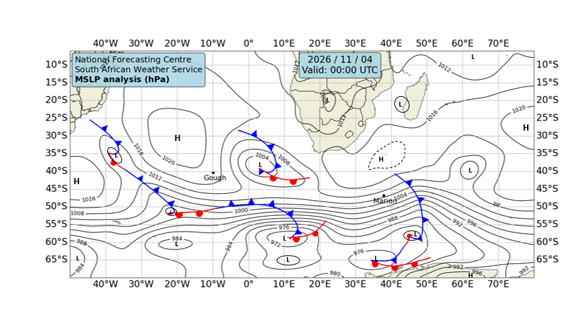

# 🌊 Cape Town — Daily Weather & Tide Report
**Generated:** 07:00 SAST | **Date:** Wednesday, 04 November 2026
**Sources:** Open-Meteo Weather & Marine API, tide-forecast.com, SAWS Synoptic Chart

---
## 📍 Current Conditions (Cape Town)

| Metric | Value |
|--------|-------|
| 🌡️ Temperature | 20.1°C |
| 💧 Humidity | 56% |
| 🌬️ Wind | 2.6 km/h from NW (309°) |
| 💨 Gusts | 7.2 km/h |
| 🔵 Pressure | 1014.2 hPa |
| 🌧️ Conditions | Partly cloudy ⛅ (Code 2) |

---
## 🗺️ SAWS Synoptic Chart

*[South African Weather Service — Synoptic Analysis](https://www.weathersa.co.za/home/synopticcharts)*

---
## 🌤️ 3-Day Weather Forecast

### 📅 Wednesday, 04 Nov
- **Conditions:** Overcast ☁️
- **Temp:** 16.9°C – 29.7°C
- **Wind:** 9.6 km/h (SW) | Gusts: 33.1 km/h
- **Precipitation:** 0.0 mm
- **UV Index:** 7.7

### 📅 Thursday, 05 Nov
- **Conditions:** Moderate drizzle 🌦️
- **Temp:** 16.3°C – 21.4°C
- **Wind:** 23.1 km/h (WNW) | Gusts: 71.3 km/h
- **Precipitation:** 3.3 mm
- **UV Index:** 7.3

### 📅 Friday, 06 Nov
- **Conditions:** Moderate drizzle 🌦️
- **Temp:** 13.9°C – 19.6°C
- **Wind:** 17.6 km/h (W) | Gusts: 52.2 km/h
- **Precipitation:** 5.8 mm
- **UV Index:** 7.6

---
## 🌊 Marine Conditions (Open-Meteo Marine)

### 📅 Wednesday, 04 Nov
- **Total wave height (max):** 1.6m
- **Swell height (max):** 1.58m 🌊
- **Wind-sea height (max):** 0.24m
- **Swell direction:** SSW (210°)
- **Swell period:** 9.3s
- 🟢 Calm swell conditions.

### 📅 Thursday, 05 Nov
- **Total wave height (max):** 2.62m
- **Swell height (max):** 2.54m 🌊
- **Wind-sea height (max):** 0.92m
- **Swell direction:** WSW (248°)
- **Swell period:** 9.35s
- 🟡 Moderate swell — manageable but watch sets.

### 📅 Friday, 06 Nov
- **Total wave height (max):** 2.62m
- **Swell height (max):** 2.54m 🌊
- **Wind-sea height (max):** 0.64m
- **Swell direction:** WSW (250°)
- **Swell period:** 8.0s
- 🟡 Moderate swell — manageable but watch sets.

### 📊 Hourly Marine Snapshot (Today)

| Time (SAST) | Wave (m) | Swell (m) | Wind Wave (m) | Swell Dir | Period (s) |
|-------------|----------|-----------|---------------|-----------|------------|
| 00:00 | 1.6 | 1.6 | 0.2 | SSW | 10.8 |
| 01:00 | 1.6 | 1.6 | 0.2 | SSW | 10.9 |
| 02:00 | 1.6 | 1.6 | 0.1 | SSW | 10.9 |
| 03:00 | 1.6 | 1.6 | 0.1 | SSW | 10.9 |
| 04:00 | 1.5 | 1.5 | 0.0 | SSW | 10.9 |
| 05:00 | 1.5 | 1.5 | 0.0 | SSW | 10.8 |
| 06:00 | 1.5 | 1.5 | 0.0 | SSW | 10.8 |
| 07:00 | 1.5 | 1.5 | 0.0 | SSW | 10.7 |
| 08:00 | 1.4 | 1.4 | 0.0 | SSW | 10.7 |
| 09:00 | 1.4 | 1.4 | 0.0 | SSW | 10.6 |
| 10:00 | 1.4 | 1.4 | 0.0 | SSW | 10.6 |
| 11:00 | 1.3 | 1.3 | 0.0 | SSW | 10.6 |
| 12:00 | 1.3 | 1.3 | 0.0 | SSW | 10.6 |
| 13:00 | 1.3 | 1.3 | 0.0 | SSW | 10.6 |
| 14:00 | 1.3 | 1.2 | 0.0 | SSW | 10.5 |
| 15:00 | 1.2 | 1.2 | 0.0 | SSW | 10.5 |
| 16:00 | 1.2 | 1.2 | 0.0 | SW | 10.4 |
| 17:00 | 1.2 | 1.2 | 0.0 | SW | 10.4 |
| 18:00 | 1.2 | 1.2 | 0.0 | SW | 10.3 |
| 19:00 | 1.2 | 1.2 | 0.0 | SW | 10.2 |
| 20:00 | 1.2 | 1.2 | 0.0 | SW | 10.1 |
| 21:00 | 1.2 | 1.2 | 0.0 | SW | 10.0 |
| 22:00 | 1.2 | 1.2 | 0.0 | SW | 9.9 |
| 23:00 | 1.2 | 1.2 | 0.0 | SW | 9.9 |

---
## 🌊 Tide Report (Cape Town)

---
## ⛵ Sailing & Navigation Notes

- **Today's max wind:** 9.6 km/h from SW
- **Today's max swell:** 1.58m
- Favorable conditions for coastal sailing and harbour work.

---
*Report generated 07:00 SAST | Cape Town, South Africa*

*Tomorrow's report drops at 7:00 AM SAST. Fair winds! 🧭*