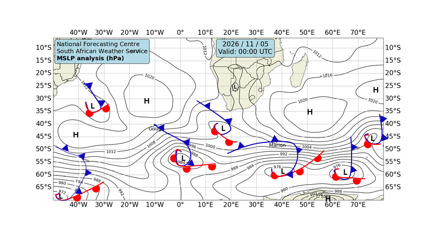

# 🌊 Cape Town — Daily Weather & Tide Report
**Generated:** 07:00 SAST | **Date:** Thursday, 05 November 2026
**Sources:** Open-Meteo Weather & Marine API, tide-forecast.com, SAWS Synoptic Chart

---
## 📍 Current Conditions (Cape Town)

| Metric | Value |
|--------|-------|
| 🌡️ Temperature | 18.4°C |
| 💧 Humidity | 75% |
| 🌬️ Wind | 5.7 km/h from NW (323°) |
| 💨 Gusts | 24.1 km/h |
| 🔵 Pressure | 1009.9 hPa |
| 🌧️ Conditions | Mainly clear 🌤️ (Code 1) |

---
## 🗺️ SAWS Synoptic Chart

*[South African Weather Service — Synoptic Analysis](https://www.weathersa.co.za/home/synopticcharts)*

---
## 🌤️ 3-Day Weather Forecast

### 📅 Thursday, 05 Nov
- **Conditions:** Dense drizzle 🌦️
- **Temp:** 16.2°C – 21.4°C
- **Wind:** 21.4 km/h (WNW) | Gusts: 67.3 km/h
- **Precipitation:** 3.8 mm
- **UV Index:** 7.85

### 📅 Friday, 06 Nov
- **Conditions:** Moderate drizzle 🌦️
- **Temp:** 13.8°C – 19.5°C
- **Wind:** 18.1 km/h (W) | Gusts: 54.4 km/h
- **Precipitation:** 3.4 mm
- **UV Index:** 8.85

### 📅 Saturday, 07 Nov
- **Conditions:** Light drizzle 🌦️
- **Temp:** 13.0°C – 19.2°C
- **Wind:** 26.8 km/h (SSE) | Gusts: 77.8 km/h
- **Precipitation:** 0.4 mm
- **UV Index:** 8.7

---
## 🌊 Marine Conditions (Open-Meteo Marine)

### 📅 Thursday, 05 Nov
- **Total wave height (max):** 2.46m
- **Swell height (max):** 2.34m 🌊
- **Wind-sea height (max):** 0.84m
- **Swell direction:** WSW (247°)
- **Swell period:** 12.25s
- 🟡 Moderate swell — manageable but watch sets.

### 📅 Friday, 06 Nov
- **Total wave height (max):** 2.5m
- **Swell height (max):** 2.34m 🌊
- **Wind-sea height (max):** 0.76m
- **Swell direction:** WSW (248°)
- **Swell period:** 8.1s
- 🟡 Moderate swell — manageable but watch sets.

### 📅 Saturday, 07 Nov
- **Total wave height (max):** 3.0m
- **Swell height (max):** 2.78m 🌊
- **Wind-sea height (max):** 1.38m
- **Swell direction:** SSW (213°)
- **Swell period:** 9.45s
- 🟡 Moderate swell — manageable but watch sets.

### 📊 Hourly Marine Snapshot (Today)

| Time (SAST) | Wave (m) | Swell (m) | Wind Wave (m) | Swell Dir | Period (s) |
|-------------|----------|-----------|---------------|-----------|------------|
| 00:00 | 1.2 | 1.1 | 0.0 | SSW | 10.5 |
| 01:00 | 1.2 | 1.0 | 0.0 | SSW | 10.7 |
| 02:00 | 1.2 | 1.0 | 0.0 | SSW | 10.9 |
| 03:00 | 1.3 | 1.0 | 0.0 | SSW | 11.2 |
| 04:00 | 1.3 | 0.9 | 0.0 | SSW | 11.5 |
| 05:00 | 1.4 | 0.9 | 0.0 | SSW | 11.7 |
| 06:00 | 1.5 | 1.0 | 0.1 | SW | 11.8 |
| 07:00 | 1.5 | 1.1 | 0.1 | WSW | 11.8 |
| 08:00 | 1.6 | 1.2 | 0.2 | W | 11.8 |
| 09:00 | 1.7 | 1.4 | 0.3 | W | 11.6 |
| 10:00 | 1.8 | 1.5 | 0.4 | WSW | 11.3 |
| 11:00 | 1.9 | 1.7 | 0.5 | WSW | 11.2 |
| 12:00 | 2.0 | 1.8 | 0.5 | WSW | 11.0 |
| 13:00 | 2.1 | 1.9 | 0.5 | WSW | 10.8 |
| 14:00 | 2.2 | 2.0 | 0.5 | WSW | 10.7 |
| 15:00 | 2.3 | 2.0 | 0.6 | WSW | 10.4 |
| 16:00 | 2.4 | 2.1 | 0.7 | WSW | 10.2 |
| 17:00 | 2.4 | 2.1 | 0.8 | WSW | 10.0 |
| 18:00 | 2.4 | 2.2 | 0.8 | WSW | 9.8 |
| 19:00 | 2.4 | 2.3 | 0.7 | WSW | 9.8 |
| 20:00 | 2.5 | 2.3 | 0.7 | WSW | 9.7 |
| 21:00 | 2.5 | 2.3 | 0.7 | WSW | 9.6 |
| 22:00 | 2.5 | 2.3 | 0.7 | WSW | 9.4 |
| 23:00 | 2.5 | 2.3 | 0.7 | WSW | 9.3 |

---
## 🌊 Tide Report (Cape Town)

---
## ⛵ Sailing & Navigation Notes

- **Today's max wind:** 21.4 km/h from WNW
- **Today's max swell:** 2.34m
- Moderate conditions — headlands and swells will be noticeable. Good for experienced sailors.

---
*Report generated 07:00 SAST | Cape Town, South Africa*

*Tomorrow's report drops at 7:00 AM SAST. Fair winds! 🧭*