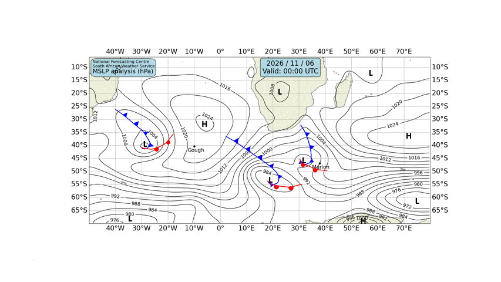

# 🌊 Cape Town — Daily Weather & Tide Report
**Generated:** 07:00 SAST | **Date:** Friday, 06 November 2026
**Sources:** Open-Meteo Weather & Marine API, tide-forecast.com, SAWS Synoptic Chart

---
## 📍 Current Conditions (Cape Town)

| Metric | Value |
|--------|-------|
| 🌡️ Temperature | 15.9°C |
| 💧 Humidity | 94% |
| 🌬️ Wind | 12.1 km/h from WNW (293°) |
| 💨 Gusts | 35.6 km/h |
| 🔵 Pressure | 1012.1 hPa |
| 🌧️ Conditions | Light drizzle 🌦️ (Code 51) |

---
## 🗺️ SAWS Synoptic Chart

*[South African Weather Service — Synoptic Analysis](https://www.weathersa.co.za/home/synopticcharts)*

---
## 🌤️ 3-Day Weather Forecast

### 📅 Friday, 06 Nov
- **Conditions:** Moderate drizzle 🌦️
- **Temp:** 14.1°C – 19.3°C
- **Wind:** 18.7 km/h (W) | Gusts: 55.1 km/h
- **Precipitation:** 4.1 mm
- **UV Index:** 8.85

### 📅 Saturday, 07 Nov
- **Conditions:** Light drizzle 🌦️
- **Temp:** 12.5°C – 18.9°C
- **Wind:** 25.4 km/h (SSE) | Gusts: 73.8 km/h
- **Precipitation:** 0.9 mm
- **UV Index:** 8.65

### 📅 Sunday, 08 Nov
- **Conditions:** Overcast ☁️
- **Temp:** 13.0°C – 27.0°C
- **Wind:** 24.4 km/h (SSE) | Gusts: 73.1 km/h
- **Precipitation:** 0.0 mm
- **UV Index:** 8.95

---
## 🌊 Marine Conditions (Open-Meteo Marine)

### 📅 Friday, 06 Nov
- **Total wave height (max):** 2.42m
- **Swell height (max):** 2.3m 🌊
- **Wind-sea height (max):** 0.8m
- **Swell direction:** WSW (248°)
- **Swell period:** 8.0s
- 🟡 Moderate swell — manageable but watch sets.

### 📅 Saturday, 07 Nov
- **Total wave height (max):** 3.06m
- **Swell height (max):** 2.88m 🌊
- **Wind-sea height (max):** 1.2m
- **Swell direction:** SW (214°)
- **Swell period:** 9.4s
- 🟡 Moderate swell — manageable but watch sets.

### 📅 Sunday, 08 Nov
- **Total wave height (max):** 2.8m
- **Swell height (max):** 2.52m 🌊
- **Wind-sea height (max):** 1.2m
- **Swell direction:** SSW (192°)
- **Swell period:** 9.3s
- 🟡 Moderate swell — manageable but watch sets.

### 📊 Hourly Marine Snapshot (Today)

| Time (SAST) | Wave (m) | Swell (m) | Wind Wave (m) | Swell Dir | Period (s) |
|-------------|----------|-----------|---------------|-----------|------------|
| 00:00 | 2.4 | 2.3 | 0.7 | WSW | 8.9 |
| 01:00 | 2.4 | 2.3 | 0.8 | WSW | 8.8 |
| 02:00 | 2.4 | 2.3 | 0.8 | WSW | 8.8 |
| 03:00 | 2.4 | 2.3 | 0.7 | WSW | 8.8 |
| 04:00 | 2.4 | 2.3 | 0.7 | WSW | 8.7 |
| 05:00 | 2.4 | 2.3 | 0.6 | WSW | 8.7 |
| 06:00 | 2.4 | 2.3 | 0.6 | WSW | 8.7 |
| 07:00 | 2.3 | 2.3 | 0.5 | WSW | 8.7 |
| 08:00 | 2.3 | 2.3 | 0.5 | WSW | 8.7 |
| 09:00 | 2.3 | 2.2 | 0.5 | WSW | 8.7 |
| 10:00 | 2.3 | 2.2 | 0.5 | WSW | 8.7 |
| 11:00 | 2.3 | 2.1 | 0.6 | WSW | 8.7 |
| 12:00 | 2.3 | 2.1 | 0.6 | WSW | 8.6 |
| 13:00 | 2.3 | 2.1 | 0.7 | WSW | 8.4 |
| 14:00 | 2.3 | 2.1 | 0.8 | WSW | 8.4 |
| 15:00 | 2.4 | 2.2 | 0.7 | WSW | 8.4 |
| 16:00 | 2.4 | 2.2 | 0.6 | WSW | 8.4 |
| 17:00 | 2.4 | 2.3 | 0.5 | SW | 8.4 |
| 18:00 | 2.4 | 2.3 | 0.6 | SW | 8.4 |
| 19:00 | 2.4 | 2.3 | 0.7 | SW | 8.3 |
| 20:00 | 2.4 | 2.3 | 0.7 | WSW | 8.3 |
| 21:00 | 2.4 | 2.3 | 0.7 | SW | 8.3 |
| 22:00 | 2.4 | 2.2 | 0.6 | SW | 8.3 |
| 23:00 | 2.4 | 2.2 | 0.6 | SW | 8.4 |

---
## 🌊 Tide Report (Cape Town)

---
## ⛵ Sailing & Navigation Notes

- **Today's max wind:** 18.7 km/h from W
- **Today's max swell:** 2.3m
- Moderate conditions — headlands and swells will be noticeable. Good for experienced sailors.

---
*Report generated 07:00 SAST | Cape Town, South Africa*

*Tomorrow's report drops at 7:00 AM SAST. Fair winds! 🧭*