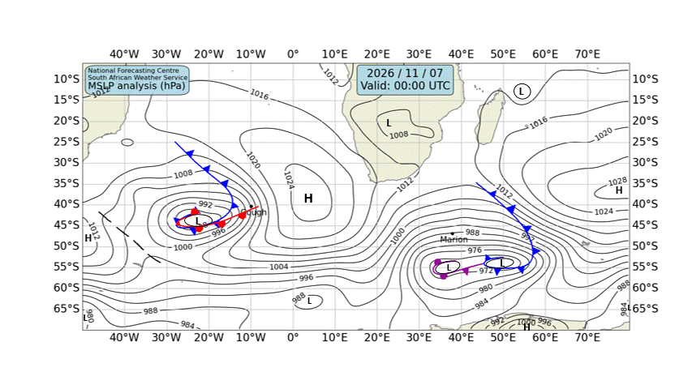

# 🌊 Cape Town — Daily Weather & Tide Report
**Generated:** 07:00 SAST | **Date:** Saturday, 07 November 2026
**Sources:** Open-Meteo Weather & Marine API, tide-forecast.com, SAWS Synoptic Chart

---
## 📍 Current Conditions (Cape Town)

| Metric | Value |
|--------|-------|
| 🌡️ Temperature | 14.5°C |
| 💧 Humidity | 74% |
| 🌬️ Wind | 8.8 km/h from S (178°) |
| 💨 Gusts | 32.8 km/h |
| 🔵 Pressure | 1020.4 hPa |
| 🌧️ Conditions | Mainly clear 🌤️ (Code 1) |

---
## 🗺️ SAWS Synoptic Chart

*[South African Weather Service — Synoptic Analysis](https://www.weathersa.co.za/home/synopticcharts)*

---
## 🌤️ 3-Day Weather Forecast

### 📅 Saturday, 07 Nov
- **Conditions:** Light drizzle 🌦️
- **Temp:** 12.7°C – 18.8°C
- **Wind:** 25.1 km/h (SSE) | Gusts: 74.2 km/h
- **Precipitation:** 1.5 mm
- **UV Index:** 8.5

### 📅 Sunday, 08 Nov
- **Conditions:** Overcast ☁️
- **Temp:** 13.2°C – 28.2°C
- **Wind:** 24.7 km/h (SE) | Gusts: 74.2 km/h
- **Precipitation:** 0.0 mm
- **UV Index:** 8.95

### 📅 Monday, 09 Nov
- **Conditions:** Overcast ☁️
- **Temp:** 15.8°C – 31.0°C
- **Wind:** 14.9 km/h (S) | Gusts: 45.0 km/h
- **Precipitation:** 0.0 mm
- **UV Index:** 8.95

---
## 🌊 Marine Conditions (Open-Meteo Marine)

### 📅 Saturday, 07 Nov
- **Total wave height (max):** 3.12m
- **Swell height (max):** 2.98m 🌊
- **Wind-sea height (max):** 1.18m
- **Swell direction:** SW (214°)
- **Swell period:** 9.6s
- 🟡 Moderate swell — manageable but watch sets.

### 📅 Sunday, 08 Nov
- **Total wave height (max):** 2.86m
- **Swell height (max):** 2.58m 🌊
- **Wind-sea height (max):** 1.22m
- **Swell direction:** SSW (193°)
- **Swell period:** 9.45s
- 🟡 Moderate swell — manageable but watch sets.

### 📅 Monday, 09 Nov
- **Total wave height (max):** 1.72m
- **Swell height (max):** 1.52m 🌊
- **Wind-sea height (max):** 0.52m
- **Swell direction:** S (190°)
- **Swell period:** 8.25s
- 🟢 Calm swell conditions.

### 📊 Hourly Marine Snapshot (Today)

| Time (SAST) | Wave (m) | Swell (m) | Wind Wave (m) | Swell Dir | Period (s) |
|-------------|----------|-----------|---------------|-----------|------------|
| 00:00 | 2.4 | 2.1 | 0.5 | WSW | 8.4 |
| 01:00 | 2.4 | 2.2 | 0.3 | SW | 8.6 |
| 02:00 | 2.4 | 2.4 | 0.2 | SW | 8.7 |
| 03:00 | 2.4 | 2.4 | 0.3 | SW | 8.8 |
| 04:00 | 2.5 | 2.4 | 0.3 | SW | 8.8 |
| 05:00 | 2.5 | 2.5 | 0.4 | SW | 9.0 |
| 06:00 | 2.5 | 2.5 | 0.4 | SW | 9.2 |
| 07:00 | 2.6 | 2.5 | 0.4 | SW | 9.4 |
| 08:00 | 2.6 | 2.5 | 0.4 | SW | 9.6 |
| 09:00 | 2.7 | 2.6 | 0.4 | SW | 9.8 |
| 10:00 | 2.7 | 2.7 | 0.4 | SW | 10.1 |
| 11:00 | 2.8 | 2.8 | 0.5 | SSW | 10.3 |
| 12:00 | 2.9 | 2.8 | 0.6 | SSW | 10.5 |
| 13:00 | 3.0 | 2.9 | 0.7 | SSW | 10.7 |
| 14:00 | 3.0 | 2.9 | 0.8 | SSW | 10.8 |
| 15:00 | 3.1 | 2.9 | 0.8 | SSW | 10.8 |
| 16:00 | 3.1 | 3.0 | 0.9 | SSW | 10.8 |
| 17:00 | 3.1 | 3.0 | 0.9 | SSW | 10.8 |
| 18:00 | 3.1 | 2.9 | 1.0 | SSW | 10.8 |
| 19:00 | 3.1 | 2.9 | 1.1 | SSW | 10.7 |
| 20:00 | 3.0 | 2.8 | 1.1 | SSW | 10.6 |
| 21:00 | 3.0 | 2.8 | 1.2 | SSW | 10.4 |
| 22:00 | 3.0 | 2.7 | 1.2 | SSW | 10.3 |
| 23:00 | 2.9 | 2.7 | 1.2 | SSW | 10.2 |

---
## 🌊 Tide Report (Cape Town)

---
## ⛵ Sailing & Navigation Notes

- **Today's max wind:** 25.1 km/h from SSE
- **Today's max swell:** 2.98m
- Moderate conditions — headlands and swells will be noticeable. Good for experienced sailors.

---
*Report generated 07:00 SAST | Cape Town, South Africa*

*Tomorrow's report drops at 7:00 AM SAST. Fair winds! 🧭*