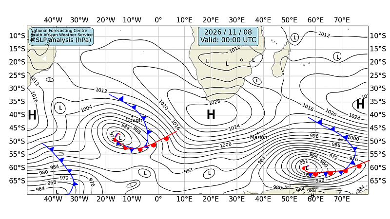

# 🌊 Cape Town — Daily Weather & Tide Report
**Generated:** 07:00 SAST | **Date:** Sunday, 08 November 2026
**Sources:** Open-Meteo Weather & Marine API, tide-forecast.com, SAWS Synoptic Chart

---
## 📍 Current Conditions (Cape Town)

| Metric | Value |
|--------|-------|
| 🌡️ Temperature | 14.9°C |
| 💧 Humidity | 72% |
| 🌬️ Wind | 15.8 km/h from SE (127°) |
| 💨 Gusts | 44.3 km/h |
| 🔵 Pressure | 1024.8 hPa |
| 🌧️ Conditions | Clear sky ☀️ (Code 0) |

---
## 🗺️ SAWS Synoptic Chart

*[South African Weather Service — Synoptic Analysis](https://www.weathersa.co.za/home/synopticcharts)*

---
## 🌤️ 3-Day Weather Forecast

### 📅 Sunday, 08 Nov
- **Conditions:** Overcast ☁️
- **Temp:** 13.3°C – 28.1°C
- **Wind:** 23.3 km/h (SE) | Gusts: 70.2 km/h
- **Precipitation:** 0.0 mm
- **UV Index:** 8.95

### 📅 Monday, 09 Nov
- **Conditions:** Overcast ☁️
- **Temp:** 15.7°C – 31.7°C
- **Wind:** 17.1 km/h (S) | Gusts: 50.4 km/h
- **Precipitation:** 0.0 mm
- **UV Index:** 8.9

### 📅 Tuesday, 10 Nov
- **Conditions:** Overcast ☁️
- **Temp:** 16.4°C – 29.0°C
- **Wind:** 18.0 km/h (S) | Gusts: 51.1 km/h
- **Precipitation:** 0.0 mm
- **UV Index:** 9.05

---
## 🌊 Marine Conditions (Open-Meteo Marine)

### 📅 Sunday, 08 Nov
- **Total wave height (max):** 2.84m
- **Swell height (max):** 2.62m 🌊
- **Wind-sea height (max):** 1.1m
- **Swell direction:** SSW (194°)
- **Swell period:** 9.45s
- 🟡 Moderate swell — manageable but watch sets.

### 📅 Monday, 09 Nov
- **Total wave height (max):** 1.68m
- **Swell height (max):** 1.54m 🌊
- **Wind-sea height (max):** 0.58m
- **Swell direction:** SSW (192°)
- **Swell period:** 8.35s
- 🟢 Calm swell conditions.

### 📅 Tuesday, 10 Nov
- **Total wave height (max):** 1.4m
- **Swell height (max):** 1.4m 🌊
- **Wind-sea height (max):** 0.58m
- **Swell direction:** SSW (212°)
- **Swell period:** 10.05s
- 🟢 Calm swell conditions.

### 📊 Hourly Marine Snapshot (Today)

| Time (SAST) | Wave (m) | Swell (m) | Wind Wave (m) | Swell Dir | Period (s) |
|-------------|----------|-----------|---------------|-----------|------------|
| 00:00 | 2.8 | 2.6 | 1.1 | SSW | 10.3 |
| 01:00 | 2.8 | 2.6 | 1.1 | SSW | 10.2 |
| 02:00 | 2.7 | 2.5 | 1.1 | SSW | 10.2 |
| 03:00 | 2.7 | 2.4 | 1.1 | SSW | 10.1 |
| 04:00 | 2.6 | 2.4 | 1.0 | SSW | 10.0 |
| 05:00 | 2.6 | 2.3 | 1.0 | SSW | 9.9 |
| 06:00 | 2.5 | 2.3 | 0.8 | SSW | 9.9 |
| 07:00 | 2.5 | 2.3 | 0.7 | SSW | 9.9 |
| 08:00 | 2.4 | 2.3 | 0.6 | SSW | 9.9 |
| 09:00 | 2.3 | 2.2 | 0.4 | SSW | 9.9 |
| 10:00 | 2.3 | 2.2 | 0.2 | SSW | 10.0 |
| 11:00 | 2.2 | 2.2 | 0.0 | SSW | 10.1 |
| 12:00 | 2.2 | 2.1 | 0.1 | SSW | 10.1 |
| 13:00 | 2.1 | 2.1 | 0.1 | SSW | 10.1 |
| 14:00 | 2.0 | 2.0 | 0.2 | SSW | 10.1 |
| 15:00 | 2.0 | 1.9 | 0.4 | SSW | 10.0 |
| 16:00 | 2.0 | 1.9 | 0.5 | SSW | 9.8 |
| 17:00 | 2.0 | 1.8 | 0.7 | SSW | 9.7 |
| 18:00 | 1.9 | 1.7 | 0.7 | SSW | 9.4 |
| 19:00 | 1.9 | 1.7 | 0.8 | SSW | 9.2 |
| 20:00 | 1.9 | 1.6 | 0.9 | SSW | 9.0 |
| 21:00 | 1.9 | 1.6 | 0.8 | SSW | 8.9 |
| 22:00 | 1.8 | 1.6 | 0.7 | SSW | 8.9 |
| 23:00 | 1.7 | 1.6 | 0.6 | SSW | 8.9 |

---
## 🌊 Tide Report (Cape Town)

---
## ⛵ Sailing & Navigation Notes

- **Today's max wind:** 23.3 km/h from SE
- **Today's max swell:** 2.62m
- Moderate conditions — headlands and swells will be noticeable. Good for experienced sailors.

---
*Report generated 07:00 SAST | Cape Town, South Africa*

*Tomorrow's report drops at 7:00 AM SAST. Fair winds! 🧭*