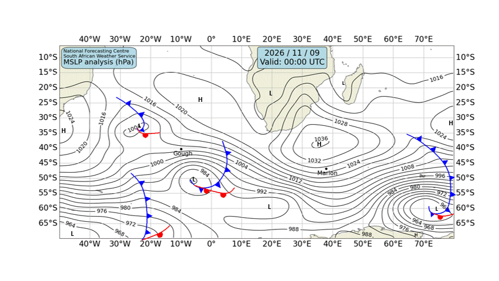

# 🌊 Cape Town — Daily Weather & Tide Report
**Generated:** 07:00 SAST | **Date:** Monday, 09 November 2026
**Sources:** Open-Meteo Weather & Marine API, tide-forecast.com, SAWS Synoptic Chart

---
## 📍 Current Conditions (Cape Town)

| Metric | Value |
|--------|-------|
| 🌡️ Temperature | 21.3°C |
| 💧 Humidity | 50% |
| 🌬️ Wind | 0.4 km/h from S (180°) |
| 💨 Gusts | 7.9 km/h |
| 🔵 Pressure | 1017.9 hPa |
| 🌧️ Conditions | Clear sky ☀️ (Code 0) |

---
## 🗺️ SAWS Synoptic Chart

*[South African Weather Service — Synoptic Analysis](https://www.weathersa.co.za/home/synopticcharts)*

---
## 🌤️ 3-Day Weather Forecast

### 📅 Monday, 09 Nov
- **Conditions:** Foggy 🌫️
- **Temp:** 16.3°C – 31.7°C
- **Wind:** 16.7 km/h (S) | Gusts: 47.9 km/h
- **Precipitation:** 0.0 mm
- **UV Index:** 8.85

### 📅 Tuesday, 10 Nov
- **Conditions:** Overcast ☁️
- **Temp:** 16.3°C – 29.7°C
- **Wind:** 18.5 km/h (S) | Gusts: 52.9 km/h
- **Precipitation:** 0.0 mm
- **UV Index:** 9.05

### 📅 Wednesday, 11 Nov
- **Conditions:** Overcast ☁️
- **Temp:** 15.7°C – 24.4°C
- **Wind:** 13.4 km/h (SW) | Gusts: 42.8 km/h
- **Precipitation:** 0.0 mm
- **UV Index:** 8.85

---
## 🌊 Marine Conditions (Open-Meteo Marine)

### 📅 Monday, 09 Nov
- **Total wave height (max):** 1.62m
- **Swell height (max):** 1.52m 🌊
- **Wind-sea height (max):** 0.64m
- **Swell direction:** SSW (195°)
- **Swell period:** 8.3s
- 🟢 Calm swell conditions.

### 📅 Tuesday, 10 Nov
- **Total wave height (max):** 1.38m
- **Swell height (max):** 1.38m 🌊
- **Wind-sea height (max):** 0.6m
- **Swell direction:** SW (215°)
- **Swell period:** 10.15s
- 🟢 Calm swell conditions.

### 📅 Wednesday, 11 Nov
- **Total wave height (max):** 2.2m
- **Swell height (max):** 2.2m 🌊
- **Wind-sea height (max):** 0.14m
- **Swell direction:** SW (236°)
- **Swell period:** 8.55s
- 🟡 Moderate swell — manageable but watch sets.

### 📊 Hourly Marine Snapshot (Today)

| Time (SAST) | Wave (m) | Swell (m) | Wind Wave (m) | Swell Dir | Period (s) |
|-------------|----------|-----------|---------------|-----------|------------|
| 00:00 | 1.6 | 1.5 | 0.4 | SSW | 9.2 |
| 01:00 | 1.6 | 1.5 | 0.3 | SSW | 9.2 |
| 02:00 | 1.5 | 1.5 | 0.2 | SSW | 9.3 |
| 03:00 | 1.5 | 1.5 | 0.1 | SSW | 9.3 |
| 04:00 | 1.4 | 1.4 | 0.1 | SSW | 9.3 |
| 05:00 | 1.4 | 1.4 | 0.0 | SSW | 9.3 |
| 06:00 | 1.4 | 1.4 | 0.0 | SSW | 9.3 |
| 07:00 | 1.3 | 1.3 | 0.0 | SSW | 9.3 |
| 08:00 | 1.3 | 1.3 | 0.0 | SSW | 9.3 |
| 09:00 | 1.3 | 1.3 | 0.0 | SSW | 9.3 |
| 10:00 | 1.3 | 1.2 | 0.0 | SSW | 9.3 |
| 11:00 | 1.2 | 1.2 | 0.0 | SSW | 9.3 |
| 12:00 | 1.2 | 1.2 | 0.1 | SSW | 9.2 |
| 13:00 | 1.2 | 1.2 | 0.2 | SSW | 9.1 |
| 14:00 | 1.2 | 1.1 | 0.4 | SSW | 8.8 |
| 15:00 | 1.2 | 1.1 | 0.4 | SSW | 8.6 |
| 16:00 | 1.2 | 1.1 | 0.5 | SSW | 8.3 |
| 17:00 | 1.2 | 1.0 | 0.5 | SSW | 8.1 |
| 18:00 | 1.2 | 1.0 | 0.4 | SSW | 8.1 |
| 19:00 | 1.2 | 0.9 | 0.4 | S | 8.2 |
| 20:00 | 1.1 | 0.9 | 0.3 | S | 8.2 |
| 21:00 | 1.1 | 0.8 | 0.4 | S | 8.1 |
| 22:00 | 1.2 | 0.8 | 0.5 | S | 7.8 |
| 23:00 | 1.2 | 0.8 | 0.6 | S | 7.7 |

---
## 🌊 Tide Report (Cape Town)

---
## ⛵ Sailing & Navigation Notes

- **Today's max wind:** 16.7 km/h from S
- **Today's max swell:** 1.52m
- Favorable conditions for coastal sailing and harbour work.

---
*Report generated 07:00 SAST | Cape Town, South Africa*

*Tomorrow's report drops at 7:00 AM SAST. Fair winds! 🧭*