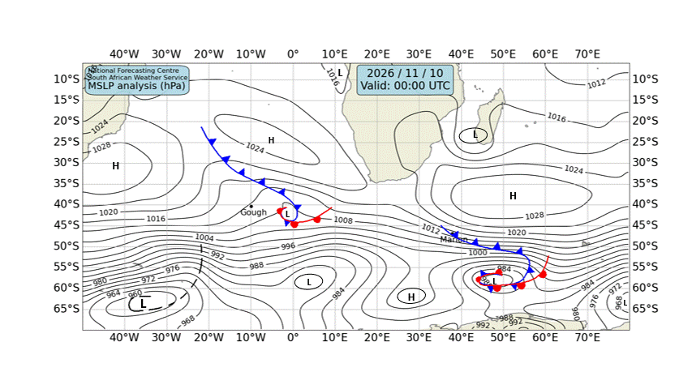

# 🌊 Cape Town — Daily Weather & Tide Report
**Generated:** 07:00 SAST | **Date:** Tuesday, 10 November 2026
**Sources:** Open-Meteo Weather & Marine API, tide-forecast.com, SAWS Synoptic Chart

---
## 📍 Current Conditions (Cape Town)

| Metric | Value |
|--------|-------|
| 🌡️ Temperature | 18.1°C |
| 💧 Humidity | 86% |
| 🌬️ Wind | 13.7 km/h from S (170°) |
| 💨 Gusts | 40.3 km/h |
| 🔵 Pressure | 1019.3 hPa |
| 🌧️ Conditions | Clear sky ☀️ (Code 0) |

---
## 🗺️ SAWS Synoptic Chart

*[South African Weather Service — Synoptic Analysis](https://www.weathersa.co.za/home/synopticcharts)*

---
## 🌤️ 3-Day Weather Forecast

### 📅 Tuesday, 10 Nov
- **Conditions:** Overcast ☁️
- **Temp:** 16.1°C – 31.1°C
- **Wind:** 17.4 km/h (S) | Gusts: 50.0 km/h
- **Precipitation:** 0.0 mm
- **UV Index:** 8.65

### 📅 Wednesday, 11 Nov
- **Conditions:** Light drizzle 🌦️
- **Temp:** 15.3°C – 23.6°C
- **Wind:** 15.1 km/h (SSW) | Gusts: 47.5 km/h
- **Precipitation:** 0.1 mm
- **UV Index:** 9.0

### 📅 Thursday, 12 Nov
- **Conditions:** Overcast ☁️
- **Temp:** 16.1°C – 24.1°C
- **Wind:** 21.3 km/h (SSE) | Gusts: 61.2 km/h
- **Precipitation:** 0.0 mm
- **UV Index:** 8.6

---
## 🌊 Marine Conditions (Open-Meteo Marine)

### 📅 Tuesday, 10 Nov
- **Total wave height (max):** 1.36m
- **Swell height (max):** 1.36m 🌊
- **Wind-sea height (max):** 0.6m
- **Swell direction:** SSW (212°)
- **Swell period:** 9.95s
- 🟢 Calm swell conditions.

### 📅 Wednesday, 11 Nov
- **Total wave height (max):** 2.36m
- **Swell height (max):** 2.34m 🌊
- **Wind-sea height (max):** 0.4m
- **Swell direction:** SW (235°)
- **Swell period:** 8.55s
- 🟡 Moderate swell — manageable but watch sets.

### 📅 Thursday, 12 Nov
- **Total wave height (max):** 2.34m
- **Swell height (max):** 2.28m 🌊
- **Wind-sea height (max):** 0.8m
- **Swell direction:** SW (233°)
- **Swell period:** 8.7s
- 🟡 Moderate swell — manageable but watch sets.

### 📊 Hourly Marine Snapshot (Today)

| Time (SAST) | Wave (m) | Swell (m) | Wind Wave (m) | Swell Dir | Period (s) |
|-------------|----------|-----------|---------------|-----------|------------|
| 00:00 | 1.2 | 0.9 | 0.6 | SSW | 8.1 |
| 01:00 | 1.2 | 0.9 | 0.6 | SSW | 8.0 |
| 02:00 | 1.2 | 0.9 | 0.5 | SSW | 8.0 |
| 03:00 | 1.1 | 0.9 | 0.5 | SSW | 8.1 |
| 04:00 | 1.1 | 0.8 | 0.5 | SSW | 8.2 |
| 05:00 | 1.1 | 0.8 | 0.5 | SSW | 8.3 |
| 06:00 | 1.1 | 0.8 | 0.4 | S | 8.5 |
| 07:00 | 1.1 | 0.8 | 0.4 | S | 8.6 |
| 08:00 | 1.1 | 0.7 | 0.4 | S | 8.8 |
| 09:00 | 1.1 | 0.8 | 0.4 | SSW | 8.9 |
| 10:00 | 1.1 | 0.8 | 0.4 | SW | 9.2 |
| 11:00 | 1.1 | 0.8 | 0.4 | WSW | 9.3 |
| 12:00 | 1.1 | 0.9 | 0.3 | WSW | 9.6 |
| 13:00 | 1.1 | 1.0 | 0.3 | WSW | 9.7 |
| 14:00 | 1.2 | 1.0 | 0.3 | WSW | 9.8 |
| 15:00 | 1.2 | 1.1 | 0.3 | WSW | 9.9 |
| 16:00 | 1.2 | 1.2 | 0.3 | SW | 9.9 |
| 17:00 | 1.3 | 1.2 | 0.3 | SW | 9.9 |
| 18:00 | 1.3 | 1.2 | 0.2 | SW | 9.9 |
| 19:00 | 1.3 | 1.3 | 0.2 | SW | 9.8 |
| 20:00 | 1.3 | 1.3 | 0.1 | SW | 9.8 |
| 21:00 | 1.3 | 1.3 | 0.1 | SW | 9.8 |
| 22:00 | 1.3 | 1.3 | 0.0 | SW | 9.8 |
| 23:00 | 1.4 | 1.4 | 0.0 | SW | 9.8 |

---
## 🌊 Tide Report (Cape Town)

---
## ⛵ Sailing & Navigation Notes

- **Today's max wind:** 17.4 km/h from S
- **Today's max swell:** 1.36m
- Favorable conditions for coastal sailing and harbour work.

---
*Report generated 07:00 SAST | Cape Town, South Africa*

*Tomorrow's report drops at 7:00 AM SAST. Fair winds! 🧭*