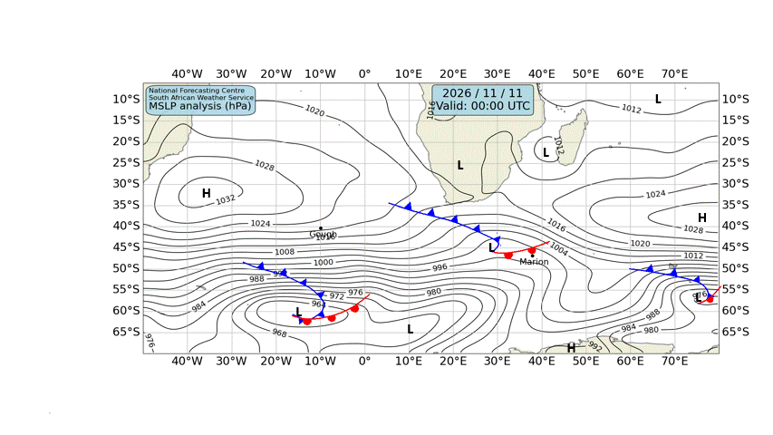

# 🌊 Cape Town — Daily Weather & Tide Report
**Generated:** 07:00 SAST | **Date:** Wednesday, 11 November 2026
**Sources:** Open-Meteo Weather & Marine API, tide-forecast.com, SAWS Synoptic Chart

---
## 📍 Current Conditions (Cape Town)

| Metric | Value |
|--------|-------|
| 🌡️ Temperature | 18.0°C |
| 💧 Humidity | 89% |
| 🌬️ Wind | 2.4 km/h from WNW (297°) |
| 💨 Gusts | 17.3 km/h |
| 🔵 Pressure | 1019.0 hPa |
| 🌧️ Conditions | Overcast ☁️ (Code 3) |

---
## 🗺️ SAWS Synoptic Chart

*[South African Weather Service — Synoptic Analysis](https://www.weathersa.co.za/home/synopticcharts)*

---
## 🌤️ 3-Day Weather Forecast

### 📅 Wednesday, 11 Nov
- **Conditions:** Light drizzle 🌦️
- **Temp:** 15.4°C – 22.6°C
- **Wind:** 14.8 km/h (SW) | Gusts: 45.0 km/h
- **Precipitation:** 0.6 mm
- **UV Index:** 9.0

### 📅 Thursday, 12 Nov
- **Conditions:** Overcast ☁️
- **Temp:** 16.1°C – 23.4°C
- **Wind:** 20.8 km/h (SSE) | Gusts: 59.8 km/h
- **Precipitation:** 0.0 mm
- **UV Index:** 9.1

### 📅 Friday, 13 Nov
- **Conditions:** Overcast ☁️
- **Temp:** 15.2°C – 22.8°C
- **Wind:** 25.1 km/h (SSE) | Gusts: 72.0 km/h
- **Precipitation:** 0.0 mm
- **UV Index:** 9.1

---
## 🌊 Marine Conditions (Open-Meteo Marine)

### 📅 Wednesday, 11 Nov
- **Total wave height (max):** 2.32m
- **Swell height (max):** 2.32m 🌊
- **Wind-sea height (max):** 0.26m
- **Swell direction:** SW (236°)
- **Swell period:** 8.6s
- 🟡 Moderate swell — manageable but watch sets.

### 📅 Thursday, 12 Nov
- **Total wave height (max):** 2.3m
- **Swell height (max):** 2.26m 🌊
- **Wind-sea height (max):** 0.8m
- **Swell direction:** SW (232°)
- **Swell period:** 8.45s
- 🟡 Moderate swell — manageable but watch sets.

### 📅 Friday, 13 Nov
- **Total wave height (max):** 2.4m
- **Swell height (max):** 2.14m 🌊
- **Wind-sea height (max):** 1.04m
- **Swell direction:** SW (225°)
- **Swell period:** 8.75s
- 🟡 Moderate swell — manageable but watch sets.

### 📊 Hourly Marine Snapshot (Today)

| Time (SAST) | Wave (m) | Swell (m) | Wind Wave (m) | Swell Dir | Period (s) |
|-------------|----------|-----------|---------------|-----------|------------|
| 00:00 | 1.3 | 1.3 | 0.0 | SW | 9.8 |
| 01:00 | 1.4 | 1.4 | 0.0 | WSW | 9.8 |
| 02:00 | 1.4 | 1.4 | 0.0 | WSW | 9.8 |
| 03:00 | 1.4 | 1.4 | 0.0 | WSW | 9.9 |
| 04:00 | 1.4 | 1.4 | 0.0 | WSW | 10.0 |
| 05:00 | 1.4 | 1.4 | 0.0 | WSW | 10.1 |
| 06:00 | 1.5 | 1.4 | 0.0 | WSW | 10.1 |
| 07:00 | 1.5 | 1.4 | 0.0 | WSW | 10.1 |
| 08:00 | 1.6 | 1.4 | 0.0 | WSW | 10.2 |
| 09:00 | 1.6 | 1.4 | 0.0 | WSW | 10.2 |
| 10:00 | 1.7 | 1.4 | 0.0 | SW | 10.2 |
| 11:00 | 1.8 | 1.4 | 0.0 | SW | 10.3 |
| 12:00 | 1.8 | 1.6 | 0.0 | SW | 10.3 |
| 13:00 | 1.9 | 1.7 | 0.1 | SW | 10.3 |
| 14:00 | 2.0 | 1.8 | 0.1 | SW | 10.3 |
| 15:00 | 2.1 | 1.9 | 0.2 | SW | 10.2 |
| 16:00 | 2.2 | 2.1 | 0.2 | SW | 10.2 |
| 17:00 | 2.2 | 2.2 | 0.2 | SW | 10.2 |
| 18:00 | 2.3 | 2.3 | 0.2 | SW | 10.2 |
| 19:00 | 2.3 | 2.3 | 0.2 | SW | 10.1 |
| 20:00 | 2.3 | 2.3 | 0.2 | SW | 10.1 |
| 21:00 | 2.3 | 2.3 | 0.2 | SW | 10.1 |
| 22:00 | 2.3 | 2.3 | 0.2 | SW | 10.1 |
| 23:00 | 2.3 | 2.3 | 0.3 | SW | 10.0 |

---
## 🌊 Tide Report (Cape Town)

---
## ⛵ Sailing & Navigation Notes

- **Today's max wind:** 14.8 km/h from SW
- **Today's max swell:** 2.32m
- Moderate conditions — headlands and swells will be noticeable. Good for experienced sailors.

---
*Report generated 07:00 SAST | Cape Town, South Africa*

*Tomorrow's report drops at 7:00 AM SAST. Fair winds! 🧭*