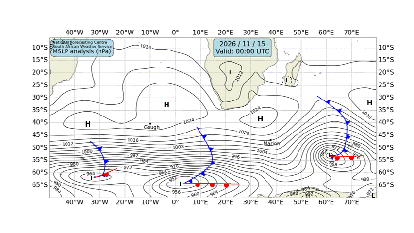

# 🌊 Cape Town — Daily Weather & Tide Report
**Generated:** 07:00 SAST | **Date:** Sunday, 15 November 2026
**Sources:** Open-Meteo Weather & Marine API, tide-forecast.com, SAWS Synoptic Chart

---
## 📍 Current Conditions (Cape Town)

| Metric | Value |
|--------|-------|
| 🌡️ Temperature | 17.6°C |
| 💧 Humidity | 78% |
| 🌬️ Wind | 14.5 km/h from SE (142°) |
| 💨 Gusts | 37.8 km/h |
| 🔵 Pressure | 1016.1 hPa |
| 🌧️ Conditions | Clear sky ☀️ (Code 0) |

---
## 🗺️ SAWS Synoptic Chart

*[South African Weather Service — Synoptic Analysis](https://www.weathersa.co.za/home/synopticcharts)*

---
## 🌤️ 3-Day Weather Forecast

### 📅 Sunday, 15 Nov
- **Conditions:** Overcast ☁️
- **Temp:** 15.7°C – 23.8°C
- **Wind:** 30.7 km/h (SSE) | Gusts: 88.6 km/h
- **Precipitation:** 0.0 mm
- **UV Index:** 9.05

### 📅 Monday, 16 Nov
- **Conditions:** Clear sky ☀️
- **Temp:** 16.8°C – 23.4°C
- **Wind:** 31.6 km/h (SE) | Gusts: 92.5 km/h
- **Precipitation:** 0.0 mm
- **UV Index:** 9.15

### 📅 Tuesday, 17 Nov
- **Conditions:** Mainly clear 🌤️
- **Temp:** 16.4°C – 30.7°C
- **Wind:** 30.7 km/h (SE) | Gusts: 87.5 km/h
- **Precipitation:** 0.0 mm
- **UV Index:** 9.2

---
## 🌊 Marine Conditions (Open-Meteo Marine)

### 📅 Sunday, 15 Nov
- **Total wave height (max):** 2.64m
- **Swell height (max):** 2.06m 🌊
- **Wind-sea height (max):** 1.58m
- **Swell direction:** SSW (198°)
- **Swell period:** 9.7s
- 🟡 Moderate swell — manageable but watch sets.

### 📅 Monday, 16 Nov
- **Total wave height (max):** 2.1m
- **Swell height (max):** 1.4m 🌊
- **Wind-sea height (max):** 1.7m
- **Swell direction:** SSW (193°)
- **Swell period:** 10.2s
- 🟢 Calm swell conditions.

### 📅 Tuesday, 17 Nov
- **Total wave height (max):** 2.12m
- **Swell height (max):** 1.3m 🌊
- **Wind-sea height (max):** 1.64m
- **Swell direction:** S (179°)
- **Swell period:** 10.2s
- 🟢 Calm swell conditions.

### 📊 Hourly Marine Snapshot (Today)

| Time (SAST) | Wave (m) | Swell (m) | Wind Wave (m) | Swell Dir | Period (s) |
|-------------|----------|-----------|---------------|-----------|------------|
| 00:00 | 2.6 | 2.1 | 1.5 | SW | 9.3 |
| 01:00 | 2.6 | 2.1 | 1.3 | SW | 9.4 |
| 02:00 | 2.5 | 2.0 | 1.2 | SW | 9.6 |
| 03:00 | 2.5 | 2.0 | 1.2 | SW | 9.6 |
| 04:00 | 2.4 | 2.0 | 1.2 | SW | 9.6 |
| 05:00 | 2.4 | 2.0 | 1.2 | SW | 9.6 |
| 06:00 | 2.4 | 2.0 | 1.2 | SW | 9.5 |
| 07:00 | 2.4 | 2.0 | 1.2 | SW | 9.4 |
| 08:00 | 2.3 | 1.9 | 1.2 | SW | 9.3 |
| 09:00 | 2.3 | 1.9 | 1.3 | SW | 9.2 |
| 10:00 | 2.3 | 1.9 | 1.3 | SW | 9.1 |
| 11:00 | 2.3 | 1.8 | 1.4 | SW | 8.8 |
| 12:00 | 2.3 | 1.8 | 1.5 | SW | 8.7 |
| 13:00 | 2.3 | 1.7 | 1.5 | SW | 8.4 |
| 14:00 | 2.3 | 1.7 | 1.6 | SW | 8.2 |
| 15:00 | 2.3 | 1.6 | 1.6 | SW | 8.1 |
| 16:00 | 2.3 | 1.6 | 1.6 | SW | 8.0 |
| 17:00 | 2.2 | 1.6 | 1.6 | SW | 7.9 |
| 18:00 | 2.2 | 1.6 | 1.5 | SW | 7.9 |
| 19:00 | 2.1 | 1.5 | 1.4 | SW | 7.9 |
| 20:00 | 2.0 | 1.5 | 1.3 | SW | 7.9 |
| 21:00 | 2.0 | 1.5 | 1.2 | SW | 7.9 |
| 22:00 | 1.9 | 1.5 | 1.1 | SW | 7.8 |
| 23:00 | 1.8 | 1.4 | 1.1 | SW | 7.8 |

---
## 🌊 Tide Report (Cape Town)

---
## ⛵ Sailing & Navigation Notes

- **Today's max wind:** 30.7 km/h from SSE
- **Today's max swell:** 2.06m
- Moderate conditions — headlands and swells will be noticeable. Good for experienced sailors.

---
*Report generated 07:00 SAST | Cape Town, South Africa*

*Tomorrow's report drops at 7:00 AM SAST. Fair winds! 🧭*