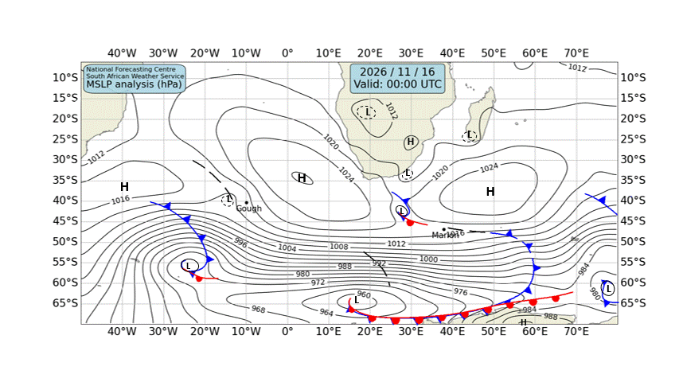

# 🌊 Cape Town — Daily Weather & Tide Report
**Generated:** 07:00 SAST | **Date:** Monday, 16 November 2026
**Sources:** Open-Meteo Weather & Marine API, tide-forecast.com, SAWS Synoptic Chart

---
## 📍 Current Conditions (Cape Town)

| Metric | Value |
|--------|-------|
| 🌡️ Temperature | 18.1°C |
| 💧 Humidity | 68% |
| 🌬️ Wind | 21.6 km/h from SE (139°) |
| 💨 Gusts | 68.8 km/h |
| 🔵 Pressure | 1022.4 hPa |
| 🌧️ Conditions | Clear sky ☀️ (Code 0) |

---
## 🗺️ SAWS Synoptic Chart

*[South African Weather Service — Synoptic Analysis](https://www.weathersa.co.za/home/synopticcharts)*

---
## 🌤️ 3-Day Weather Forecast

### 📅 Monday, 16 Nov
- **Conditions:** Clear sky ☀️
- **Temp:** 16.7°C – 23.9°C
- **Wind:** 31.1 km/h (SE) | Gusts: 88.6 km/h
- **Precipitation:** 0.0 mm
- **UV Index:** 9.0

### 📅 Tuesday, 17 Nov
- **Conditions:** Partly cloudy ⛅
- **Temp:** 16.3°C – 31.6°C
- **Wind:** 28.7 km/h (SE) | Gusts: 83.5 km/h
- **Precipitation:** 0.0 mm
- **UV Index:** 9.1

### 📅 Wednesday, 18 Nov
- **Conditions:** Mainly clear 🌤️
- **Temp:** 15.3°C – 36.7°C
- **Wind:** 13.5 km/h (SSE) | Gusts: 40.0 km/h
- **Precipitation:** 0.0 mm
- **UV Index:** 9.2

---
## 🌊 Marine Conditions (Open-Meteo Marine)

### 📅 Monday, 16 Nov
- **Total wave height (max):** 2.08m
- **Swell height (max):** 1.56m 🌊
- **Wind-sea height (max):** 1.7m
- **Swell direction:** SSW (196°)
- **Swell period:** 10.4s
- 🟢 Calm swell conditions.

### 📅 Tuesday, 17 Nov
- **Total wave height (max):** 2.08m
- **Swell height (max):** 1.34m 🌊
- **Wind-sea height (max):** 1.64m
- **Swell direction:** S (178°)
- **Swell period:** 10.4s
- 🟢 Calm swell conditions.

### 📅 Wednesday, 18 Nov
- **Total wave height (max):** 1.9m
- **Swell height (max):** 1.32m 🌊
- **Wind-sea height (max):** 0.94m
- **Swell direction:** S (189°)
- **Swell period:** 9.4s
- 🟢 Calm swell conditions.

### 📊 Hourly Marine Snapshot (Today)

| Time (SAST) | Wave (m) | Swell (m) | Wind Wave (m) | Swell Dir | Period (s) |
|-------------|----------|-----------|---------------|-----------|------------|
| 00:00 | 1.9 | 1.6 | 0.9 | SW | 8.3 |
| 01:00 | 1.8 | 1.5 | 0.9 | SW | 8.2 |
| 02:00 | 1.8 | 1.5 | 0.9 | SW | 8.2 |
| 03:00 | 1.8 | 1.4 | 0.9 | SW | 8.1 |
| 04:00 | 1.7 | 1.4 | 0.9 | SW | 8.1 |
| 05:00 | 1.7 | 1.3 | 0.9 | SW | 8.0 |
| 06:00 | 1.7 | 1.3 | 0.9 | SW | 7.9 |
| 07:00 | 1.7 | 1.3 | 0.9 | SW | 7.8 |
| 08:00 | 1.6 | 1.3 | 0.8 | SW | 7.8 |
| 09:00 | 1.6 | 1.3 | 0.9 | SW | 7.7 |
| 10:00 | 1.7 | 1.2 | 1.0 | SW | 7.5 |
| 11:00 | 1.7 | 1.1 | 1.1 | SW | 7.3 |
| 12:00 | 1.7 | 1.1 | 1.2 | SW | 7.2 |
| 13:00 | 1.7 | 1.1 | 1.2 | SW | 7.0 |
| 14:00 | 1.8 | 1.1 | 1.3 | SW | 7.0 |
| 15:00 | 1.8 | 1.1 | 1.4 | SW | 6.8 |
| 16:00 | 1.9 | 1.0 | 1.5 | WSW | 6.8 |
| 17:00 | 2.0 | 1.0 | 1.6 | WSW | 6.8 |
| 18:00 | 2.0 | 1.0 | 1.6 | SW | 6.8 |
| 19:00 | 2.0 | 0.9 | 1.7 | SW | 6.8 |
| 20:00 | 2.1 | 0.9 | 1.7 | SW | 6.8 |
| 21:00 | 2.1 | 1.0 | 1.7 | SW | 6.9 |
| 22:00 | 2.1 | 1.0 | 1.7 | SW | 7.0 |
| 23:00 | 2.1 | 1.0 | 1.7 | SW | 7.1 |

---
## 🌊 Tide Report (Cape Town)

---
## ⛵ Sailing & Navigation Notes

- **Today's max wind:** 31.1 km/h from SE
- **Today's max swell:** 1.56m
- Favorable conditions for coastal sailing and harbour work.

---
*Report generated 07:00 SAST | Cape Town, South Africa*

*Tomorrow's report drops at 7:00 AM SAST. Fair winds! 🧭*