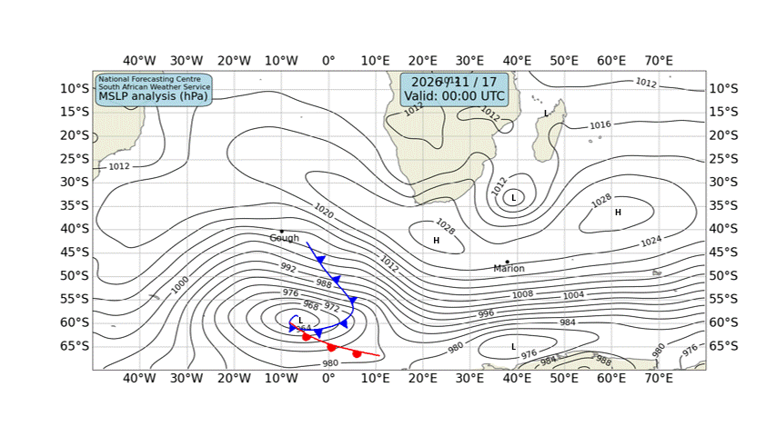

# 🌊 Cape Town — Daily Weather & Tide Report
**Generated:** 07:00 SAST | **Date:** Tuesday, 17 November 2026
**Sources:** Open-Meteo Weather & Marine API, tide-forecast.com, SAWS Synoptic Chart

---
## 📍 Current Conditions (Cape Town)

| Metric | Value |
|--------|-------|
| 🌡️ Temperature | 17.8°C |
| 💧 Humidity | 71% |
| 🌬️ Wind | 15.8 km/h from SE (135°) |
| 💨 Gusts | 53.3 km/h |
| 🔵 Pressure | 1019.0 hPa |
| 🌧️ Conditions | Clear sky ☀️ (Code 0) |

---
## 🗺️ SAWS Synoptic Chart

*[South African Weather Service — Synoptic Analysis](https://www.weathersa.co.za/home/synopticcharts)*

---
## 🌤️ 3-Day Weather Forecast

### 📅 Tuesday, 17 Nov
- **Conditions:** Clear sky ☀️
- **Temp:** 16.0°C – 31.4°C
- **Wind:** 29.8 km/h (SE) | Gusts: 79.2 km/h
- **Precipitation:** 0.0 mm
- **UV Index:** 9.05

### 📅 Wednesday, 18 Nov
- **Conditions:** Overcast ☁️
- **Temp:** 15.2°C – 36.6°C
- **Wind:** 13.5 km/h (S) | Gusts: 39.6 km/h
- **Precipitation:** 0.0 mm
- **UV Index:** 9.2

### 📅 Thursday, 19 Nov
- **Conditions:** Foggy 🌫️
- **Temp:** 17.3°C – 24.6°C
- **Wind:** 16.9 km/h (SSW) | Gusts: 47.5 km/h
- **Precipitation:** 0.0 mm
- **UV Index:** 9.15

---
## 🌊 Marine Conditions (Open-Meteo Marine)

### 📅 Tuesday, 17 Nov
- **Total wave height (max):** 2.16m
- **Swell height (max):** 1.42m 🌊
- **Wind-sea height (max):** 1.58m
- **Swell direction:** S (180°)
- **Swell period:** 10.5s
- 🟢 Calm swell conditions.

### 📅 Wednesday, 18 Nov
- **Total wave height (max):** 1.98m
- **Swell height (max):** 1.36m 🌊
- **Wind-sea height (max):** 0.96m
- **Swell direction:** SSW (192°)
- **Swell period:** 9.7s
- 🟢 Calm swell conditions.

### 📅 Thursday, 19 Nov
- **Total wave height (max):** 1.6m
- **Swell height (max):** 1.48m 🌊
- **Wind-sea height (max):** 0.52m
- **Swell direction:** SW (218°)
- **Swell period:** 9.6s
- 🟢 Calm swell conditions.

### 📊 Hourly Marine Snapshot (Today)

| Time (SAST) | Wave (m) | Swell (m) | Wind Wave (m) | Swell Dir | Period (s) |
|-------------|----------|-----------|---------------|-----------|------------|
| 00:00 | 2.1 | 1.1 | 1.6 | SW | 7.3 |
| 01:00 | 2.1 | 1.1 | 1.6 | SW | 7.5 |
| 02:00 | 2.1 | 1.1 | 1.5 | SW | 7.7 |
| 03:00 | 2.1 | 1.2 | 1.5 | SW | 7.8 |
| 04:00 | 2.1 | 1.2 | 1.5 | SW | 7.8 |
| 05:00 | 2.1 | 1.2 | 1.5 | SW | 8.0 |
| 06:00 | 2.0 | 1.2 | 1.3 | SW | 8.2 |
| 07:00 | 2.0 | 1.3 | 1.1 | SW | 8.5 |
| 08:00 | 2.0 | 1.3 | 0.9 | SW | 8.8 |
| 09:00 | 1.9 | 1.3 | 0.7 | SW | 9.0 |
| 10:00 | 1.9 | 1.3 | 0.6 | SW | 9.2 |
| 11:00 | 1.8 | 1.3 | 0.5 | SW | 9.3 |
| 12:00 | 1.9 | 1.3 | 0.6 | SW | 9.4 |
| 13:00 | 1.9 | 1.4 | 0.8 | SW | 9.3 |
| 14:00 | 1.9 | 1.4 | 1.0 | SW | 9.2 |
| 15:00 | 2.0 | 1.4 | 1.2 | SW | 9.0 |
| 16:00 | 2.0 | 1.4 | 1.3 | SW | 8.7 |
| 17:00 | 2.1 | 1.4 | 1.5 | SW | 8.5 |
| 18:00 | 2.1 | 1.4 | 1.5 | SW | 8.4 |
| 19:00 | 2.1 | 1.4 | 1.5 | SW | 8.3 |
| 20:00 | 2.2 | 1.4 | 1.6 | SW | 8.3 |
| 21:00 | 2.1 | 1.4 | 1.4 | SW | 8.4 |
| 22:00 | 2.1 | 1.4 | 1.3 | SW | 8.5 |
| 23:00 | 2.0 | 1.3 | 1.2 | SW | 8.7 |

---
## 🌊 Tide Report (Cape Town)

---
## ⛵ Sailing & Navigation Notes

- **Today's max wind:** 29.8 km/h from SE
- **Today's max swell:** 1.42m
- Favorable conditions for coastal sailing and harbour work.

---
*Report generated 07:00 SAST | Cape Town, South Africa*

*Tomorrow's report drops at 7:00 AM SAST. Fair winds! 🧭*