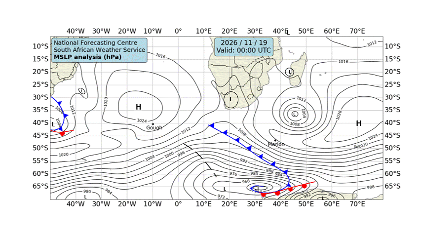

# 🌊 Cape Town — Daily Weather & Tide Report
**Generated:** 07:00 SAST | **Date:** Thursday, 19 November 2026
**Sources:** Open-Meteo Weather & Marine API, tide-forecast.com, SAWS Synoptic Chart

---
## 📍 Current Conditions (Cape Town)

| Metric | Value |
|--------|-------|
| 🌡️ Temperature | 18.4°C |
| 💧 Humidity | 91% |
| 🌬️ Wind | 10.3 km/h from SSE (165°) |
| 💨 Gusts | 31.0 km/h |
| 🔵 Pressure | 1012.6 hPa |
| 🌧️ Conditions | Overcast ☁️ (Code 3) |

---
## 🗺️ SAWS Synoptic Chart

*[South African Weather Service — Synoptic Analysis](https://www.weathersa.co.za/home/synopticcharts)*

---
## 🌤️ 3-Day Weather Forecast

### 📅 Thursday, 19 Nov
- **Conditions:** Foggy 🌫️
- **Temp:** 17.1°C – 25.0°C
- **Wind:** 15.6 km/h (SSW) | Gusts: 46.1 km/h
- **Precipitation:** 0.0 mm
- **UV Index:** 8.8

### 📅 Friday, 20 Nov
- **Conditions:** Overcast ☁️
- **Temp:** 15.3°C – 23.9°C
- **Wind:** 16.4 km/h (S) | Gusts: 47.9 km/h
- **Precipitation:** 0.0 mm
- **UV Index:** 9.15

### 📅 Saturday, 21 Nov
- **Conditions:** Light drizzle 🌦️
- **Temp:** 13.5°C – 20.1°C
- **Wind:** 19.3 km/h (WNW) | Gusts: 59.0 km/h
- **Precipitation:** 2.4 mm
- **UV Index:** 9.2

---
## 🌊 Marine Conditions (Open-Meteo Marine)

### 📅 Thursday, 19 Nov
- **Total wave height (max):** 1.58m
- **Swell height (max):** 1.42m 🌊
- **Wind-sea height (max):** 0.34m
- **Swell direction:** SW (221°)
- **Swell period:** 9.65s
- 🟢 Calm swell conditions.

### 📅 Friday, 20 Nov
- **Total wave height (max):** 2.04m
- **Swell height (max):** 2.02m 🌊
- **Wind-sea height (max):** 0.52m
- **Swell direction:** SW (226°)
- **Swell period:** 8.9s
- 🟡 Moderate swell — manageable but watch sets.

### 📅 Saturday, 21 Nov
- **Total wave height (max):** 3.08m
- **Swell height (max):** 3.08m 🌊
- **Wind-sea height (max):** 0.42m
- **Swell direction:** SW (233°)
- **Swell period:** 9.05s
- ⚠️ **Heavy swell** — headlands exposed. Use caution.

### 📊 Hourly Marine Snapshot (Today)

| Time (SAST) | Wave (m) | Swell (m) | Wind Wave (m) | Swell Dir | Period (s) |
|-------------|----------|-----------|---------------|-----------|------------|
| 00:00 | 1.4 | 1.2 | 0.3 | SW | 9.9 |
| 01:00 | 1.3 | 1.2 | 0.2 | SW | 10.0 |
| 02:00 | 1.3 | 1.2 | 0.1 | SW | 10.1 |
| 03:00 | 1.3 | 1.2 | 0.2 | SW | 10.2 |
| 04:00 | 1.4 | 1.2 | 0.2 | SW | 10.2 |
| 05:00 | 1.4 | 1.2 | 0.2 | SW | 10.3 |
| 06:00 | 1.4 | 1.2 | 0.2 | SW | 10.3 |
| 07:00 | 1.4 | 1.3 | 0.1 | SW | 10.3 |
| 08:00 | 1.4 | 1.3 | 0.1 | SW | 10.3 |
| 09:00 | 1.4 | 1.3 | 0.1 | SW | 10.3 |
| 10:00 | 1.4 | 1.4 | 0.1 | SW | 10.3 |
| 11:00 | 1.5 | 1.4 | 0.2 | SW | 10.2 |
| 12:00 | 1.5 | 1.4 | 0.2 | SW | 10.2 |
| 13:00 | 1.5 | 1.4 | 0.2 | SW | 10.2 |
| 14:00 | 1.5 | 1.4 | 0.2 | SW | 10.1 |
| 15:00 | 1.5 | 1.4 | 0.2 | SW | 10.1 |
| 16:00 | 1.5 | 1.4 | 0.1 | SW | 10.1 |
| 17:00 | 1.5 | 1.4 | 0.1 | SW | 10.1 |
| 18:00 | 1.5 | 1.4 | 0.2 | SW | 10.1 |
| 19:00 | 1.5 | 1.4 | 0.3 | SW | 9.9 |
| 20:00 | 1.5 | 1.4 | 0.3 | SW | 9.8 |
| 21:00 | 1.5 | 1.4 | 0.3 | SW | 9.8 |
| 22:00 | 1.6 | 1.4 | 0.3 | SW | 9.7 |
| 23:00 | 1.6 | 1.4 | 0.3 | SW | 9.6 |

---
## 🌊 Tide Report (Cape Town)

---
## ⛵ Sailing & Navigation Notes

- **Today's max wind:** 15.6 km/h from SSW
- **Today's max swell:** 1.42m
- Favorable conditions for coastal sailing and harbour work.

---
*Report generated 07:00 SAST | Cape Town, South Africa*

*Tomorrow's report drops at 7:00 AM SAST. Fair winds! 🧭*