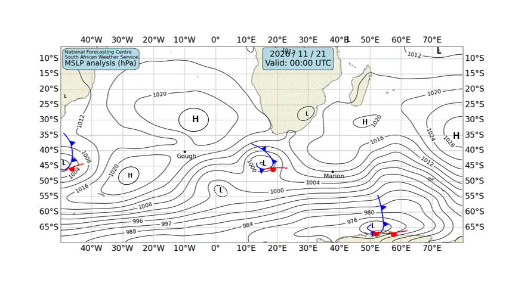

# 🌊 Cape Town — Daily Weather & Tide Report
**Generated:** 07:00 SAST | **Date:** Saturday, 21 November 2026
**Sources:** Open-Meteo Weather & Marine API, tide-forecast.com, SAWS Synoptic Chart

---
## 📍 Current Conditions (Cape Town)

| Metric | Value |
|--------|-------|
| 🌡️ Temperature | 17.0°C |
| 💧 Humidity | 63% |
| 🌬️ Wind | 7.6 km/h from WNW (284°) |
| 💨 Gusts | 27.4 km/h |
| 🔵 Pressure | 1016.9 hPa |
| 🌧️ Conditions | Overcast ☁️ (Code 3) |

---
## 🗺️ SAWS Synoptic Chart

*[South African Weather Service — Synoptic Analysis](https://www.weathersa.co.za/home/synopticcharts)*

---
## 🌤️ 3-Day Weather Forecast

### 📅 Saturday, 21 Nov
- **Conditions:** Light drizzle 🌦️
- **Temp:** 14.0°C – 21.1°C
- **Wind:** 16.4 km/h (WNW) | Gusts: 52.6 km/h
- **Precipitation:** 0.2 mm
- **UV Index:** 9.2

### 📅 Sunday, 22 Nov
- **Conditions:** Overcast ☁️
- **Temp:** 14.6°C – 21.2°C
- **Wind:** 16.7 km/h (SW) | Gusts: 49.3 km/h
- **Precipitation:** 0.0 mm
- **UV Index:** 9.2

### 📅 Monday, 23 Nov
- **Conditions:** Overcast ☁️
- **Temp:** 14.9°C – 22.9°C
- **Wind:** 22.2 km/h (SSE) | Gusts: 63.7 km/h
- **Precipitation:** 0.0 mm
- **UV Index:** 9.15

---
## 🌊 Marine Conditions (Open-Meteo Marine)

### 📅 Saturday, 21 Nov
- **Total wave height (max):** 3.1m
- **Swell height (max):** 3.1m 🌊
- **Wind-sea height (max):** 0.24m
- **Swell direction:** SW (232°)
- **Swell period:** 9.35s
- ⚠️ **Heavy swell** — headlands exposed. Use caution.

### 📅 Sunday, 22 Nov
- **Total wave height (max):** 3.36m
- **Swell height (max):** 3.36m 🌊
- **Wind-sea height (max):** 0.4m
- **Swell direction:** SW (234°)
- **Swell period:** 9.75s
- ⚠️ **Heavy swell** — headlands exposed. Use caution.

### 📅 Monday, 23 Nov
- **Total wave height (max):** 2.64m
- **Swell height (max):** 2.62m 🌊
- **Wind-sea height (max):** 0.84m
- **Swell direction:** SW (224°)
- **Swell period:** 8.65s
- 🟡 Moderate swell — manageable but watch sets.

### 📊 Hourly Marine Snapshot (Today)

| Time (SAST) | Wave (m) | Swell (m) | Wind Wave (m) | Swell Dir | Period (s) |
|-------------|----------|-----------|---------------|-----------|------------|
| 00:00 | 2.1 | 2.1 | 0.1 | SW | 10.4 |
| 01:00 | 2.1 | 2.1 | 0.1 | SW | 10.4 |
| 02:00 | 2.1 | 2.1 | 0.1 | SW | 10.4 |
| 03:00 | 2.1 | 2.1 | 0.1 | SW | 10.4 |
| 04:00 | 2.1 | 2.0 | 0.1 | SW | 10.3 |
| 05:00 | 2.1 | 2.0 | 0.2 | SW | 10.3 |
| 06:00 | 2.1 | 2.0 | 0.1 | SW | 10.2 |
| 07:00 | 2.0 | 2.0 | 0.1 | SW | 10.2 |
| 08:00 | 2.0 | 2.0 | 0.1 | SW | 10.1 |
| 09:00 | 2.0 | 2.0 | 0.1 | SW | 9.9 |
| 10:00 | 2.0 | 2.0 | 0.1 | SW | 9.8 |
| 11:00 | 2.0 | 2.0 | 0.1 | SW | 9.8 |
| 12:00 | 2.1 | 2.0 | 0.2 | SW | 9.7 |
| 13:00 | 2.1 | 2.1 | 0.2 | SW | 9.5 |
| 14:00 | 2.1 | 2.1 | 0.2 | SW | 9.4 |
| 15:00 | 2.2 | 2.2 | 0.2 | SW | 9.4 |
| 16:00 | 2.3 | 2.3 | 0.2 | SW | 9.5 |
| 17:00 | 2.4 | 2.4 | 0.2 | SW | 9.7 |
| 18:00 | 2.6 | 2.5 | 0.2 | SW | 9.8 |
| 19:00 | 2.7 | 2.7 | 0.1 | SW | 10.2 |
| 20:00 | 2.8 | 2.8 | 0.1 | SW | 10.4 |
| 21:00 | 2.9 | 2.9 | 0.1 | SW | 10.7 |
| 22:00 | 3.0 | 3.0 | 0.0 | SW | 10.9 |
| 23:00 | 3.1 | 3.1 | 0.0 | SW | 11.2 |

---
## 🌊 Tide Report (Cape Town)

---
## ⛵ Sailing & Navigation Notes

- **Today's max wind:** 16.4 km/h from WNW
- **Today's max swell:** 3.1m
- ⚠️ **Caution for small craft** — swell above 3m. Consider sheltered waters or postponing offshore passages.

---
*Report generated 07:00 SAST | Cape Town, South Africa*

*Tomorrow's report drops at 7:00 AM SAST. Fair winds! 🧭*