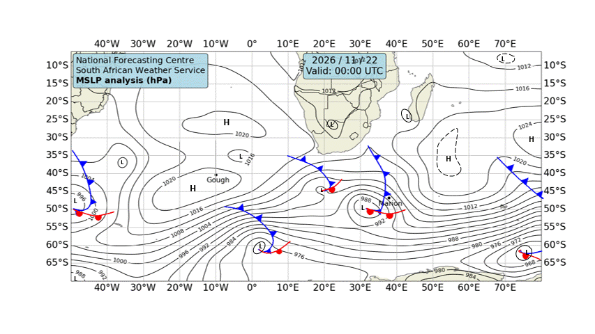

# 🌊 Cape Town — Daily Weather & Tide Report
**Generated:** 07:00 SAST | **Date:** Sunday, 22 November 2026
**Sources:** Open-Meteo Weather & Marine API, tide-forecast.com, SAWS Synoptic Chart

---
## 📍 Current Conditions (Cape Town)

| Metric | Value |
|--------|-------|
| 🌡️ Temperature | 16.3°C |
| 💧 Humidity | 77% |
| 🌬️ Wind | 6.7 km/h from WSW (246°) |
| 💨 Gusts | 22.3 km/h |
| 🔵 Pressure | 1018.2 hPa |
| 🌧️ Conditions | Overcast ☁️ (Code 3) |

---
## 🗺️ SAWS Synoptic Chart

*[South African Weather Service — Synoptic Analysis](https://www.weathersa.co.za/home/synopticcharts)*

---
## 🌤️ 3-Day Weather Forecast

### 📅 Sunday, 22 Nov
- **Conditions:** Overcast ☁️
- **Temp:** 14.1°C – 21.0°C
- **Wind:** 19.4 km/h (SW) | Gusts: 56.9 km/h
- **Precipitation:** 0.0 mm
- **UV Index:** 9.15

### 📅 Monday, 23 Nov
- **Conditions:** Overcast ☁️
- **Temp:** 15.7°C – 22.9°C
- **Wind:** 22.3 km/h (SSE) | Gusts: 65.9 km/h
- **Precipitation:** 0.0 mm
- **UV Index:** 8.7

### 📅 Tuesday, 24 Nov
- **Conditions:** Overcast ☁️
- **Temp:** 15.6°C – 23.9°C
- **Wind:** 22.9 km/h (SSE) | Gusts: 67.3 km/h
- **Precipitation:** 0.0 mm
- **UV Index:** 9.2

---
## 🌊 Marine Conditions (Open-Meteo Marine)

### 📅 Sunday, 22 Nov
- **Total wave height (max):** 3.26m
- **Swell height (max):** 3.26m 🌊
- **Wind-sea height (max):** 0.48m
- **Swell direction:** SW (233°)
- **Swell period:** 9.5s
- ⚠️ **Heavy swell** — headlands exposed. Use caution.

### 📅 Monday, 23 Nov
- **Total wave height (max):** 2.66m
- **Swell height (max):** 2.62m 🌊
- **Wind-sea height (max):** 0.9m
- **Swell direction:** SW (221°)
- **Swell period:** 8.75s
- 🟡 Moderate swell — manageable but watch sets.

### 📅 Tuesday, 24 Nov
- **Total wave height (max):** 1.8m
- **Swell height (max):** 1.64m 🌊
- **Wind-sea height (max):** 0.8m
- **Swell direction:** SW (215°)
- **Swell period:** 9.0s
- 🟢 Calm swell conditions.

### 📊 Hourly Marine Snapshot (Today)

| Time (SAST) | Wave (m) | Swell (m) | Wind Wave (m) | Swell Dir | Period (s) |
|-------------|----------|-----------|---------------|-----------|------------|
| 00:00 | 3.1 | 3.1 | 0.1 | SW | 11.2 |
| 01:00 | 3.1 | 3.1 | 0.1 | SW | 11.3 |
| 02:00 | 3.2 | 3.2 | 0.1 | SW | 11.3 |
| 03:00 | 3.2 | 3.2 | 0.1 | SW | 11.3 |
| 04:00 | 3.2 | 3.2 | 0.1 | SW | 11.3 |
| 05:00 | 3.2 | 3.2 | 0.1 | SW | 11.3 |
| 06:00 | 3.2 | 3.2 | 0.1 | SW | 11.2 |
| 07:00 | 3.3 | 3.3 | 0.0 | SW | 11.1 |
| 08:00 | 3.3 | 3.3 | 0.0 | SW | 11.0 |
| 09:00 | 3.2 | 3.2 | 0.0 | SW | 10.9 |
| 10:00 | 3.2 | 3.2 | 0.0 | SW | 10.8 |
| 11:00 | 3.2 | 3.1 | 0.0 | SW | 10.8 |
| 12:00 | 3.2 | 3.1 | 0.0 | SW | 10.8 |
| 13:00 | 3.1 | 3.1 | 0.0 | SW | 10.7 |
| 14:00 | 3.1 | 3.1 | 0.0 | SW | 10.6 |
| 15:00 | 3.1 | 3.1 | 0.1 | SW | 10.6 |
| 16:00 | 3.0 | 3.0 | 0.3 | SW | 10.5 |
| 17:00 | 3.0 | 3.0 | 0.4 | SW | 10.4 |
| 18:00 | 2.9 | 2.9 | 0.4 | SW | 10.4 |
| 19:00 | 2.9 | 2.9 | 0.4 | SW | 10.4 |
| 20:00 | 2.8 | 2.8 | 0.4 | SW | 10.4 |
| 21:00 | 2.8 | 2.8 | 0.5 | SW | 10.4 |
| 22:00 | 2.7 | 2.7 | 0.5 | SW | 10.3 |
| 23:00 | 2.7 | 2.7 | 0.5 | SW | 10.2 |

---
## 🌊 Tide Report (Cape Town)

---
## ⛵ Sailing & Navigation Notes

- **Today's max wind:** 19.4 km/h from SW
- **Today's max swell:** 3.26m
- ⚠️ **Caution for small craft** — swell above 3m. Consider sheltered waters or postponing offshore passages.

---
*Report generated 07:00 SAST | Cape Town, South Africa*

*Tomorrow's report drops at 7:00 AM SAST. Fair winds! 🧭*