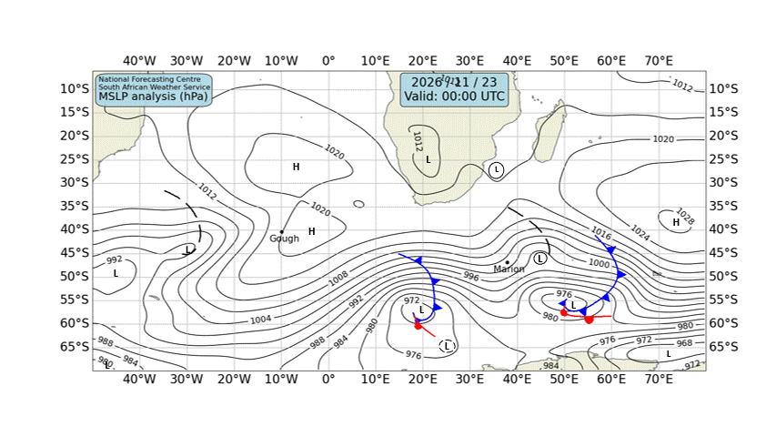

# 🌊 Cape Town — Daily Weather & Tide Report
**Generated:** 07:00 SAST | **Date:** Monday, 23 November 2026
**Sources:** Open-Meteo Weather & Marine API, tide-forecast.com, SAWS Synoptic Chart

---
## 📍 Current Conditions (Cape Town)

| Metric | Value |
|--------|-------|
| 🌡️ Temperature | 17.2°C |
| 💧 Humidity | 74% |
| 🌬️ Wind | 14.3 km/h from SSE (161°) |
| 💨 Gusts | 39.2 km/h |
| 🔵 Pressure | 1016.3 hPa |
| 🌧️ Conditions | Overcast ☁️ (Code 3) |

---
## 🗺️ SAWS Synoptic Chart

*[South African Weather Service — Synoptic Analysis](https://www.weathersa.co.za/home/synopticcharts)*

---
## 🌤️ 3-Day Weather Forecast

### 📅 Monday, 23 Nov
- **Conditions:** Dense drizzle 🌦️
- **Temp:** 15.4°C – 22.5°C
- **Wind:** 19.8 km/h (SSE) | Gusts: 58.7 km/h
- **Precipitation:** 2.3 mm
- **UV Index:** 8.55

### 📅 Tuesday, 24 Nov
- **Conditions:** Overcast ☁️
- **Temp:** 14.2°C – 23.3°C
- **Wind:** 22.9 km/h (SSE) | Gusts: 66.2 km/h
- **Precipitation:** 0.0 mm
- **UV Index:** 9.2

### 📅 Wednesday, 25 Nov
- **Conditions:** Overcast ☁️
- **Temp:** 15.6°C – 26.2°C
- **Wind:** 24.4 km/h (SSE) | Gusts: 68.8 km/h
- **Precipitation:** 0.0 mm
- **UV Index:** 9.4

---
## 🌊 Marine Conditions (Open-Meteo Marine)

### 📅 Monday, 23 Nov
- **Total wave height (max):** 2.82m
- **Swell height (max):** 2.76m 🌊
- **Wind-sea height (max):** 0.78m
- **Swell direction:** SW (223°)
- **Swell period:** 8.95s
- 🟡 Moderate swell — manageable but watch sets.

### 📅 Tuesday, 24 Nov
- **Total wave height (max):** 1.74m
- **Swell height (max):** 1.6m 🌊
- **Wind-sea height (max):** 0.7m
- **Swell direction:** SW (217°)
- **Swell period:** 8.65s
- 🟢 Calm swell conditions.

### 📅 Wednesday, 25 Nov
- **Total wave height (max):** 1.74m
- **Swell height (max):** 1.62m 🌊
- **Wind-sea height (max):** 1.14m
- **Swell direction:** SSW (198°)
- **Swell period:** 8.55s
- 🟢 Calm swell conditions.

### 📊 Hourly Marine Snapshot (Today)

| Time (SAST) | Wave (m) | Swell (m) | Wind Wave (m) | Swell Dir | Period (s) |
|-------------|----------|-----------|---------------|-----------|------------|
| 00:00 | 2.8 | 2.8 | 0.5 | SW | 10.4 |
| 01:00 | 2.8 | 2.7 | 0.6 | SW | 10.3 |
| 02:00 | 2.7 | 2.7 | 0.6 | SW | 10.2 |
| 03:00 | 2.7 | 2.6 | 0.6 | SW | 10.2 |
| 04:00 | 2.6 | 2.6 | 0.5 | SW | 10.1 |
| 05:00 | 2.6 | 2.5 | 0.5 | SW | 9.9 |
| 06:00 | 2.5 | 2.4 | 0.5 | SW | 9.8 |
| 07:00 | 2.5 | 2.4 | 0.5 | SW | 9.7 |
| 08:00 | 2.5 | 2.3 | 0.6 | SW | 9.6 |
| 09:00 | 2.4 | 2.3 | 0.6 | SW | 9.4 |
| 10:00 | 2.4 | 2.3 | 0.6 | SW | 9.3 |
| 11:00 | 2.3 | 2.2 | 0.6 | SW | 9.3 |
| 12:00 | 2.3 | 2.2 | 0.7 | SW | 9.2 |
| 13:00 | 2.2 | 2.1 | 0.7 | SW | 9.2 |
| 14:00 | 2.2 | 2.0 | 0.7 | SW | 9.1 |
| 15:00 | 2.1 | 2.0 | 0.7 | SW | 9.0 |
| 16:00 | 2.1 | 1.9 | 0.8 | SW | 8.9 |
| 17:00 | 2.1 | 1.9 | 0.8 | SW | 8.9 |
| 18:00 | 2.0 | 1.9 | 0.7 | SW | 8.9 |
| 19:00 | 2.0 | 1.8 | 0.6 | SW | 8.9 |
| 20:00 | 1.9 | 1.8 | 0.5 | SW | 8.9 |
| 21:00 | 1.9 | 1.7 | 0.5 | SW | 8.9 |
| 22:00 | 1.8 | 1.7 | 0.5 | SW | 8.9 |
| 23:00 | 1.8 | 1.6 | 0.4 | SW | 8.8 |

---
## 🌊 Tide Report (Cape Town)

---
## ⛵ Sailing & Navigation Notes

- **Today's max wind:** 19.8 km/h from SSE
- **Today's max swell:** 2.76m
- Moderate conditions — headlands and swells will be noticeable. Good for experienced sailors.

---
*Report generated 07:00 SAST | Cape Town, South Africa*

*Tomorrow's report drops at 7:00 AM SAST. Fair winds! 🧭*