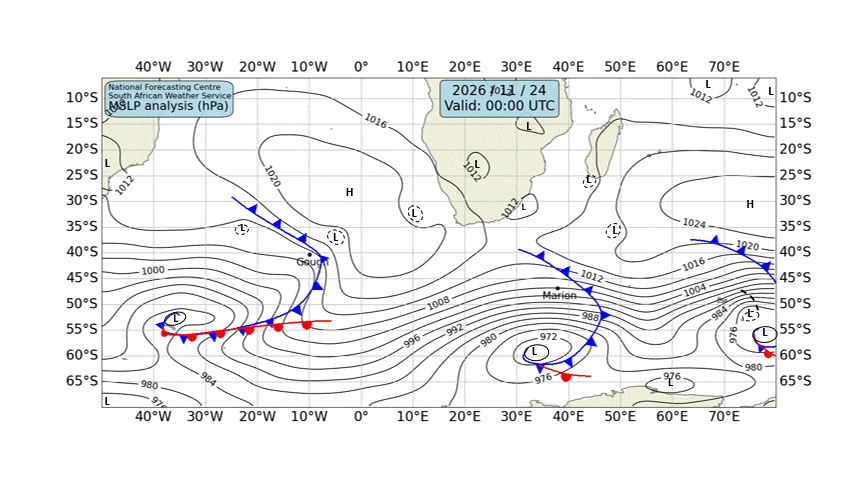

# 🌊 Cape Town — Daily Weather & Tide Report
**Generated:** 07:00 SAST | **Date:** Tuesday, 24 November 2026
**Sources:** Open-Meteo Weather & Marine API, tide-forecast.com, SAWS Synoptic Chart

---
## 📍 Current Conditions (Cape Town)

| Metric | Value |
|--------|-------|
| 🌡️ Temperature | 17.6°C |
| 💧 Humidity | 60% |
| 🌬️ Wind | 14.3 km/h from SSE (152°) |
| 💨 Gusts | 42.5 km/h |
| 🔵 Pressure | 1019.5 hPa |
| 🌧️ Conditions | Clear sky ☀️ (Code 0) |

---
## 🗺️ SAWS Synoptic Chart

*[South African Weather Service — Synoptic Analysis](https://www.weathersa.co.za/home/synopticcharts)*

---
## 🌤️ 3-Day Weather Forecast

### 📅 Tuesday, 24 Nov
- **Conditions:** Overcast ☁️
- **Temp:** 14.9°C – 23.8°C
- **Wind:** 22.2 km/h (SSE) | Gusts: 66.2 km/h
- **Precipitation:** 0.0 mm
- **UV Index:** 9.2

### 📅 Wednesday, 25 Nov
- **Conditions:** Overcast ☁️
- **Temp:** 15.3°C – 26.7°C
- **Wind:** 23.8 km/h (SSE) | Gusts: 67.0 km/h
- **Precipitation:** 0.0 mm
- **UV Index:** 9.35

### 📅 Thursday, 26 Nov
- **Conditions:** Overcast ☁️
- **Temp:** 16.3°C – 28.3°C
- **Wind:** 23.4 km/h (SSE) | Gusts: 63.0 km/h
- **Precipitation:** 0.0 mm
- **UV Index:** 9.45

---
## 🌊 Marine Conditions (Open-Meteo Marine)

### 📅 Tuesday, 24 Nov
- **Total wave height (max):** 1.82m
- **Swell height (max):** 1.74m 🌊
- **Wind-sea height (max):** 0.72m
- **Swell direction:** SW (218°)
- **Swell period:** 8.6s
- 🟢 Calm swell conditions.

### 📅 Wednesday, 25 Nov
- **Total wave height (max):** 1.72m
- **Swell height (max):** 1.58m 🌊
- **Wind-sea height (max):** 1.12m
- **Swell direction:** SSW (198°)
- **Swell period:** 8.6s
- 🟢 Calm swell conditions.

### 📅 Thursday, 26 Nov
- **Total wave height (max):** 1.68m
- **Swell height (max):** 1.22m 🌊
- **Wind-sea height (max):** 1.44m
- **Swell direction:** S (181°)
- **Swell period:** 8.25s
- 🟢 Calm swell conditions.

### 📊 Hourly Marine Snapshot (Today)

| Time (SAST) | Wave (m) | Swell (m) | Wind Wave (m) | Swell Dir | Period (s) |
|-------------|----------|-----------|---------------|-----------|------------|
| 00:00 | 1.8 | 1.7 | 0.4 | SW | 9.1 |
| 01:00 | 1.8 | 1.7 | 0.4 | SW | 9.1 |
| 02:00 | 1.8 | 1.7 | 0.5 | SW | 9.0 |
| 03:00 | 1.7 | 1.6 | 0.4 | SW | 9.0 |
| 04:00 | 1.7 | 1.6 | 0.3 | SW | 8.9 |
| 05:00 | 1.7 | 1.5 | 0.3 | SW | 8.9 |
| 06:00 | 1.6 | 1.5 | 0.3 | SW | 8.9 |
| 07:00 | 1.6 | 1.5 | 0.3 | SW | 8.9 |
| 08:00 | 1.6 | 1.5 | 0.3 | SW | 8.9 |
| 09:00 | 1.5 | 1.5 | 0.3 | SW | 8.9 |
| 10:00 | 1.5 | 1.5 | 0.3 | SW | 8.9 |
| 11:00 | 1.5 | 1.5 | 0.3 | SW | 9.0 |
| 12:00 | 1.5 | 1.4 | 0.3 | SW | 9.0 |
| 13:00 | 1.5 | 1.4 | 0.4 | SW | 9.0 |
| 14:00 | 1.5 | 1.4 | 0.5 | SW | 9.0 |
| 15:00 | 1.5 | 1.4 | 0.5 | SW | 8.9 |
| 16:00 | 1.6 | 1.4 | 0.6 | SW | 8.9 |
| 17:00 | 1.6 | 1.5 | 0.6 | SW | 8.9 |
| 18:00 | 1.6 | 1.5 | 0.7 | SW | 8.9 |
| 19:00 | 1.6 | 1.5 | 0.7 | SW | 8.9 |
| 20:00 | 1.6 | 1.5 | 0.7 | SW | 8.9 |
| 21:00 | 1.7 | 1.5 | 0.7 | SSW | 8.9 |
| 22:00 | 1.7 | 1.5 | 0.7 | SSW | 8.9 |
| 23:00 | 1.7 | 1.5 | 0.7 | SSW | 8.9 |

---
## 🌊 Tide Report (Cape Town)

---
## ⛵ Sailing & Navigation Notes

- **Today's max wind:** 22.2 km/h from SSE
- **Today's max swell:** 1.74m
- Favorable conditions for coastal sailing and harbour work.

---
*Report generated 07:00 SAST | Cape Town, South Africa*

*Tomorrow's report drops at 7:00 AM SAST. Fair winds! 🧭*