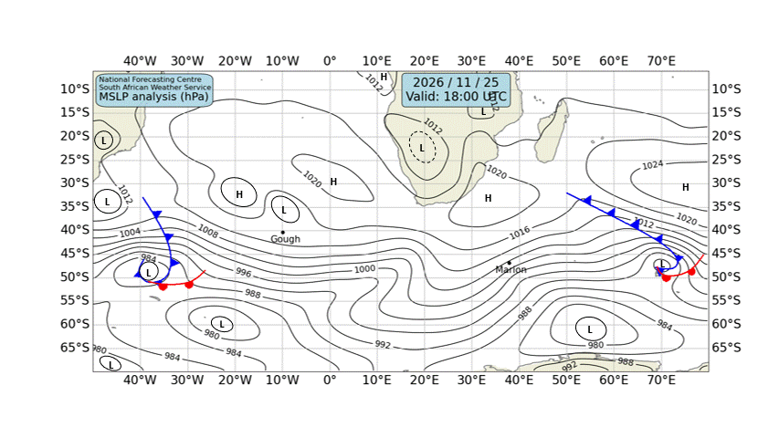

# 🌊 Cape Town — Daily Weather & Tide Report
**Generated:** 07:00 SAST | **Date:** Thursday, 26 November 2026
**Sources:** Open-Meteo Weather & Marine API, tide-forecast.com, SAWS Synoptic Chart

---
## 📍 Current Conditions (Cape Town)

| Metric | Value |
|--------|-------|
| 🌡️ Temperature | 18.5°C |
| 💧 Humidity | 73% |
| 🌬️ Wind | 11.2 km/h from SSE (154°) |
| 💨 Gusts | 34.2 km/h |
| 🔵 Pressure | 1013.2 hPa |
| 🌧️ Conditions | Mainly clear 🌤️ (Code 1) |

---
## 🗺️ SAWS Synoptic Chart

*[South African Weather Service — Synoptic Analysis](https://www.weathersa.co.za/home/synopticcharts)*

---
## 🌤️ 3-Day Weather Forecast

### 📅 Thursday, 26 Nov
- **Conditions:** Overcast ☁️
- **Temp:** 15.6°C – 27.2°C
- **Wind:** 24.6 km/h (SSE) | Gusts: 65.2 km/h
- **Precipitation:** 0.0 mm
- **UV Index:** 9.5

### 📅 Friday, 27 Nov
- **Conditions:** Overcast ☁️
- **Temp:** 14.8°C – 23.9°C
- **Wind:** 15.2 km/h (WSW) | Gusts: 44.6 km/h
- **Precipitation:** 0.0 mm
- **UV Index:** 8.95

### 📅 Saturday, 28 Nov
- **Conditions:** Moderate drizzle 🌦️
- **Temp:** 15.9°C – 21.5°C
- **Wind:** 17.2 km/h (NW) | Gusts: 52.6 km/h
- **Precipitation:** 5.0 mm
- **UV Index:** 6.2

---
## 🌊 Marine Conditions (Open-Meteo Marine)

### 📅 Thursday, 26 Nov
- **Total wave height (max):** 1.66m
- **Swell height (max):** 1.3m 🌊
- **Wind-sea height (max):** 1.34m
- **Swell direction:** S (185°)
- **Swell period:** 8.35s
- 🟢 Calm swell conditions.

### 📅 Friday, 27 Nov
- **Total wave height (max):** 1.4m
- **Swell height (max):** 0.96m 🌊
- **Wind-sea height (max):** 0.86m
- **Swell direction:** SSW (196°)
- **Swell period:** 6.85s
- 🟢 Calm swell conditions.

### 📅 Saturday, 28 Nov
- **Total wave height (max):** 1.32m
- **Swell height (max):** 1.28m 🌊
- **Wind-sea height (max):** 0.36m
- **Swell direction:** WSW (239°)
- **Swell period:** 5.95s
- 🟢 Calm swell conditions.

### 📊 Hourly Marine Snapshot (Today)

| Time (SAST) | Wave (m) | Swell (m) | Wind Wave (m) | Swell Dir | Period (s) |
|-------------|----------|-----------|---------------|-----------|------------|
| 00:00 | 1.7 | 1.3 | 1.0 | SSW | 7.5 |
| 01:00 | 1.7 | 1.2 | 1.0 | SSW | 7.5 |
| 02:00 | 1.6 | 1.2 | 1.0 | SW | 7.4 |
| 03:00 | 1.6 | 1.1 | 0.9 | SSW | 7.5 |
| 04:00 | 1.5 | 1.0 | 0.8 | SSW | 7.5 |
| 05:00 | 1.5 | 1.0 | 0.7 | S | 7.5 |
| 06:00 | 1.5 | 1.0 | 0.8 | SSW | 7.3 |
| 07:00 | 1.5 | 1.0 | 0.9 | SSW | 7.0 |
| 08:00 | 1.5 | 1.0 | 1.1 | SSW | 6.8 |
| 09:00 | 1.5 | 1.0 | 1.0 | SSW | 6.8 |
| 10:00 | 1.5 | 1.0 | 1.0 | SSW | 6.8 |
| 11:00 | 1.5 | 1.0 | 0.9 | SSW | 6.7 |
| 12:00 | 1.5 | 0.9 | 1.0 | SSW | 6.7 |
| 13:00 | 1.5 | 0.8 | 1.0 | SSW | 6.6 |
| 14:00 | 1.4 | 0.8 | 1.0 | SSW | 6.5 |
| 15:00 | 1.5 | 0.8 | 1.1 | SSW | 6.3 |
| 16:00 | 1.5 | 0.8 | 1.2 | SSW | 6.2 |
| 17:00 | 1.5 | 0.8 | 1.3 | SW | 6.0 |
| 18:00 | 1.6 | 0.8 | 1.3 | SW | 5.9 |
| 19:00 | 1.6 | 0.8 | 1.3 | SW | 5.8 |
| 20:00 | 1.6 | 0.8 | 1.3 | SW | 5.8 |
| 21:00 | 1.5 | 0.8 | 1.2 | SW | 5.9 |
| 22:00 | 1.5 | 0.8 | 1.1 | SSW | 6.0 |
| 23:00 | 1.5 | 0.8 | 1.0 | SSW | 6.1 |

---
## 🌊 Tide Report (Cape Town)

---
## ⛵ Sailing & Navigation Notes

- **Today's max wind:** 24.6 km/h from SSE
- **Today's max swell:** 1.3m
- Favorable conditions for coastal sailing and harbour work.

---
*Report generated 07:00 SAST | Cape Town, South Africa*

*Tomorrow's report drops at 7:00 AM SAST. Fair winds! 🧭*