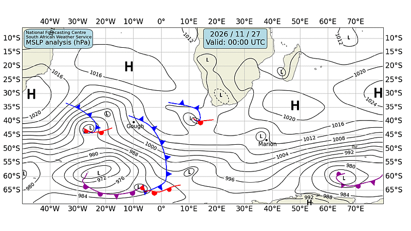

# 🌊 Cape Town — Daily Weather & Tide Report
**Generated:** 07:00 SAST | **Date:** Friday, 27 November 2026
**Sources:** Open-Meteo Weather & Marine API, tide-forecast.com, SAWS Synoptic Chart

---
## 📍 Current Conditions (Cape Town)

| Metric | Value |
|--------|-------|
| 🌡️ Temperature | 17.5°C |
| 💧 Humidity | 86% |
| 🌬️ Wind | 2.4 km/h from WSW (243°) |
| 💨 Gusts | 12.2 km/h |
| 🔵 Pressure | 1009.6 hPa |
| 🌧️ Conditions | Overcast ☁️ (Code 3) |

---
## 🗺️ SAWS Synoptic Chart

*[South African Weather Service — Synoptic Analysis](https://www.weathersa.co.za/home/synopticcharts)*

---
## 🌤️ 3-Day Weather Forecast

### 📅 Friday, 27 Nov
- **Conditions:** Overcast ☁️
- **Temp:** 14.9°C – 23.6°C
- **Wind:** 15.3 km/h (WSW) | Gusts: 43.9 km/h
- **Precipitation:** 0.0 mm
- **UV Index:** 9.35

### 📅 Saturday, 28 Nov
- **Conditions:** Moderate drizzle 🌦️
- **Temp:** 15.7°C – 22.3°C
- **Wind:** 12.3 km/h (W) | Gusts: 40.3 km/h
- **Precipitation:** 2.0 mm
- **UV Index:** 9.45

### 📅 Sunday, 29 Nov
- **Conditions:** Overcast ☁️
- **Temp:** 16.3°C – 24.7°C
- **Wind:** 14.6 km/h (SW) | Gusts: 42.8 km/h
- **Precipitation:** 0.0 mm
- **UV Index:** 9.5

---
## 🌊 Marine Conditions (Open-Meteo Marine)

### 📅 Friday, 27 Nov
- **Total wave height (max):** 1.36m
- **Swell height (max):** 0.94m 🌊
- **Wind-sea height (max):** 0.78m
- **Swell direction:** SSW (195°)
- **Swell period:** 7.85s
- 🟢 Calm swell conditions.

### 📅 Saturday, 28 Nov
- **Total wave height (max):** 1.58m
- **Swell height (max):** 1.54m 🌊
- **Wind-sea height (max):** 0.24m
- **Swell direction:** SW (228°)
- **Swell period:** 6.9s
- 🟢 Calm swell conditions.

### 📅 Sunday, 29 Nov
- **Total wave height (max):** 1.5m
- **Swell height (max):** 1.48m 🌊
- **Wind-sea height (max):** 0.4m
- **Swell direction:** SSW (205°)
- **Swell period:** 6.6s
- 🟢 Calm swell conditions.

### 📊 Hourly Marine Snapshot (Today)

| Time (SAST) | Wave (m) | Swell (m) | Wind Wave (m) | Swell Dir | Period (s) |
|-------------|----------|-----------|---------------|-----------|------------|
| 00:00 | 1.4 | 0.7 | 0.8 | SSW | 6.4 |
| 01:00 | 1.3 | 0.7 | 0.7 | SSW | 6.5 |
| 02:00 | 1.3 | 0.7 | 0.7 | SSW | 6.5 |
| 03:00 | 1.2 | 0.7 | 0.6 | SSW | 6.5 |
| 04:00 | 1.2 | 0.7 | 0.5 | SSW | 6.5 |
| 05:00 | 1.2 | 0.7 | 0.4 | SSW | 6.5 |
| 06:00 | 1.2 | 0.7 | 0.4 | SSW | 6.5 |
| 07:00 | 1.1 | 0.8 | 0.3 | S | 6.5 |
| 08:00 | 1.1 | 0.8 | 0.2 | S | 6.6 |
| 09:00 | 1.1 | 0.8 | 0.2 | S | 6.7 |
| 10:00 | 1.1 | 0.9 | 0.2 | SSW | 6.8 |
| 11:00 | 1.0 | 0.9 | 0.2 | SSW | 6.8 |
| 12:00 | 1.0 | 0.9 | 0.2 | SSW | 6.8 |
| 13:00 | 1.0 | 0.8 | 0.1 | SSW | 6.8 |
| 14:00 | 1.0 | 0.8 | 0.1 | SSW | 6.8 |
| 15:00 | 0.9 | 0.8 | 0.1 | SSW | 6.9 |
| 16:00 | 0.9 | 0.7 | 0.1 | SSW | 7.0 |
| 17:00 | 0.9 | 0.7 | 0.0 | SSW | 7.0 |
| 18:00 | 0.9 | 0.7 | 0.0 | SSW | 7.0 |
| 19:00 | 0.9 | 0.7 | 0.0 | SW | 7.0 |
| 20:00 | 0.8 | 0.7 | 0.0 | SW | 7.0 |
| 21:00 | 0.8 | 0.6 | 0.0 | SW | 7.0 |
| 22:00 | 0.8 | 0.6 | 0.0 | SSW | 6.8 |
| 23:00 | 0.8 | 0.6 | 0.0 | SSW | 6.8 |

---
## 🌊 Tide Report (Cape Town)

---
## ⛵ Sailing & Navigation Notes

- **Today's max wind:** 15.3 km/h from WSW
- **Today's max swell:** 0.94m
- Favorable conditions for coastal sailing and harbour work.

---
*Report generated 07:00 SAST | Cape Town, South Africa*

*Tomorrow's report drops at 7:00 AM SAST. Fair winds! 🧭*