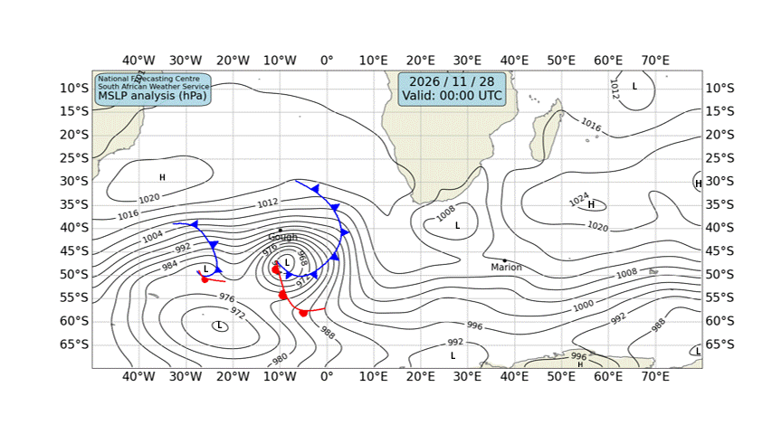

# 🌊 Cape Town — Daily Weather & Tide Report
**Generated:** 07:00 SAST | **Date:** Saturday, 28 November 2026
**Sources:** Open-Meteo Weather & Marine API, tide-forecast.com, SAWS Synoptic Chart

---
## 📍 Current Conditions (Cape Town)

| Metric | Value |
|--------|-------|
| 🌡️ Temperature | 17.1°C |
| 💧 Humidity | 97% |
| 🌬️ Wind | 5.1 km/h from WNW (293°) |
| 💨 Gusts | 19.1 km/h |
| 🔵 Pressure | 1016.7 hPa |
| 🌧️ Conditions | Mainly clear 🌤️ (Code 1) |

---
## 🗺️ SAWS Synoptic Chart

*[South African Weather Service — Synoptic Analysis](https://www.weathersa.co.za/home/synopticcharts)*

---
## 🌤️ 3-Day Weather Forecast

### 📅 Saturday, 28 Nov
- **Conditions:** Dense drizzle 🌦️
- **Temp:** 15.8°C – 22.0°C
- **Wind:** 12.1 km/h (WNW) | Gusts: 38.5 km/h
- **Precipitation:** 2.7 mm
- **UV Index:** 9.5

### 📅 Sunday, 29 Nov
- **Conditions:** Light drizzle 🌦️
- **Temp:** 16.4°C – 24.0°C
- **Wind:** 14.7 km/h (SW) | Gusts: 43.2 km/h
- **Precipitation:** 0.8 mm
- **UV Index:** 4.55

### 📅 Monday, 30 Nov
- **Conditions:** Mainly clear 🌤️
- **Temp:** 15.8°C – 25.3°C
- **Wind:** 20.4 km/h (SSE) | Gusts: 56.5 km/h
- **Precipitation:** 0.0 mm
- **UV Index:** 9.55

---
## 🌊 Marine Conditions (Open-Meteo Marine)

### 📅 Saturday, 28 Nov
- **Total wave height (max):** 1.66m
- **Swell height (max):** 1.64m 🌊
- **Wind-sea height (max):** 0.12m
- **Swell direction:** SW (223°)
- **Swell period:** 6.8s
- 🟢 Calm swell conditions.

### 📅 Sunday, 29 Nov
- **Total wave height (max):** 1.52m
- **Swell height (max):** 1.5m 🌊
- **Wind-sea height (max):** 0.52m
- **Swell direction:** SSW (205°)
- **Swell period:** 6.75s
- 🟢 Calm swell conditions.

### 📅 Monday, 30 Nov
- **Total wave height (max):** 2.54m
- **Swell height (max):** 2.42m 🌊
- **Wind-sea height (max):** 0.84m
- **Swell direction:** SW (226°)
- **Swell period:** 13.45s
- 🟡 Moderate swell — manageable but watch sets.

### 📊 Hourly Marine Snapshot (Today)

| Time (SAST) | Wave (m) | Swell (m) | Wind Wave (m) | Swell Dir | Period (s) |
|-------------|----------|-----------|---------------|-----------|------------|
| 00:00 | 0.8 | 0.7 | 0.1 | SW | 6.8 |
| 01:00 | 0.9 | 0.7 | 0.1 | SW | 6.8 |
| 02:00 | 0.9 | 0.7 | 0.1 | SW | 6.8 |
| 03:00 | 1.0 | 0.8 | 0.1 | SW | 6.8 |
| 04:00 | 1.1 | 0.9 | 0.1 | SW | 6.9 |
| 05:00 | 1.2 | 1.0 | 0.1 | SW | 7.0 |
| 06:00 | 1.3 | 1.1 | 0.0 | SW | 7.1 |
| 07:00 | 1.4 | 1.3 | 0.0 | SW | 7.2 |
| 08:00 | 1.5 | 1.4 | 0.0 | SW | 7.3 |
| 09:00 | 1.5 | 1.5 | 0.0 | SW | 7.4 |
| 10:00 | 1.5 | 1.5 | 0.0 | SW | 7.5 |
| 11:00 | 1.6 | 1.6 | 0.0 | SW | 7.5 |
| 12:00 | 1.6 | 1.6 | 0.0 | SW | 7.7 |
| 13:00 | 1.6 | 1.6 | 0.0 | SW | 7.8 |
| 14:00 | 1.6 | 1.6 | 0.0 | SW | 7.8 |
| 15:00 | 1.6 | 1.6 | 0.0 | SW | 8.0 |
| 16:00 | 1.6 | 1.6 | 0.0 | SW | 8.0 |
| 17:00 | 1.7 | 1.6 | 0.0 | SW | 8.1 |
| 18:00 | 1.6 | 1.6 | 0.0 | SW | 8.2 |
| 19:00 | 1.6 | 1.6 | 0.0 | SW | 8.3 |
| 20:00 | 1.6 | 1.5 | 0.0 | SW | 8.3 |
| 21:00 | 1.6 | 1.5 | 0.0 | SW | 8.3 |
| 22:00 | 1.6 | 1.5 | 0.0 | SSW | 8.3 |
| 23:00 | 1.6 | 1.5 | 0.0 | SSW | 8.3 |

---
## 🌊 Tide Report (Cape Town)

---
## ⛵ Sailing & Navigation Notes

- **Today's max wind:** 12.1 km/h from WNW
- **Today's max swell:** 1.64m
- Favorable conditions for coastal sailing and harbour work.

---
*Report generated 07:00 SAST | Cape Town, South Africa*

*Tomorrow's report drops at 7:00 AM SAST. Fair winds! 🧭*